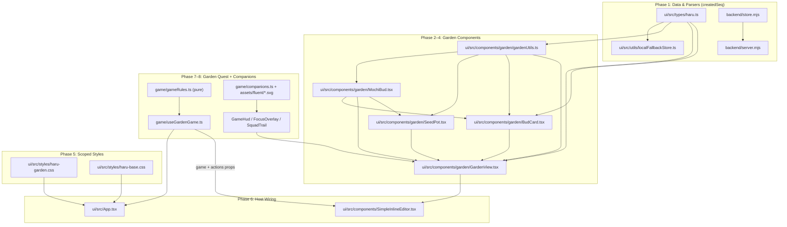

# Haru "🌱 Garden" Tab: Step-by-Step Implementation Plan

> Companion to [`garden-tab-requirements.md`](./garden-tab-requirements.md) · Target: `haru/` · Zero new npm dependencies

This document translates the design and requirements in [`garden-tab-requirements.md`](./garden-tab-requirements.md) into a self-contained, file-by-file implementation blueprint so any coding model or engineer can implement it in a single pass.

---

## Architecture & File Map



| Phase | Action | File Path | Purpose |
|---|---|---|---|
| **1** | Modify | `haru/ui/src/types/haru.ts` | Add `createdSeq?: number` and `createdAt?: string` to `HaruBlock` |
| **1** | Modify | `haru/ui/src/utils/localFallbackStore.ts` | Preserve/assign `createdSeq` & `createdAt` + legacy migration |
| **1** | Modify | `haru/backend/store.mjs` | Identical `createdSeq` logic in `parseMarkdownIntoBlocks` + migration in `loadStore` |
| **2** | Create | `haru/ui/src/components/garden/gardenUtils.ts` | Palette (6 pastel hues), `getBudStatus`, `sortByCreation`, section helpers |
| **2** | Create | `haru/ui/src/components/garden/MochiBud.tsx` | Pure inline SVG character (`idle`, `running`, `done`, `failed`, `review`, `sleepy`) |
| **3** | Create | `haru/ui/src/components/garden/SeedPot.tsx` | Cute "Plant a new bud… 🌱" input card + target section selector |
| **3** | Create | `haru/ui/src/components/garden/BudCard.tsx` | Task card: `#n` badge, `MochiBud`, inline title edit, baby buds, expandable `TaskControlBar` |
| **4** | Create | `haru/ui/src/components/garden/GardenView.tsx` | Header stats, progress vine, "Hide bloomed" toggle, parade grid, empty/all-done states |
| **5** | Create | `haru/ui/src/styles/haru-garden.css` | Scoped `.haru-shell .haru-garden` tokens, layout, keyframes, `prefers-reduced-motion` |
| **5** | Modify | `haru/ui/src/styles/haru-base.css` | Add `.haru-simple-workspace-body.mode-garden` rule |
| **6** | Modify | `haru/ui/src/components/SimpleInlineEditor.tsx` | Add `'garden'` to `ViewMode`, 4th button, persist `haru.viewMode.v1`, render `<GardenView>` |
| **6** | Modify | `haru/ui/src/App.tsx` | Import `haru-garden.css?inline` into `haruCss`; ensure initial load migrates missing `createdSeq` |
| **7** | Modify | `haru/README.md` | Document the new **🌱 Garden** view |
| **7** | Create | `haru/ui/src/components/garden/game/gameTypes.ts` | `GardenGameState`, `GardenGameActions`, `GameEvent` types |
| **7** | Create | `haru/ui/src/components/garden/game/gameRules.ts` | Pure reward/streak/level/leader/timer functions (no React, `now` injected) |
| **7** | Create | `haru/ui/src/components/garden/game/useGardenGame.ts` | Hook: load/merge/persist, diff `doc.blocks` → rewards, clock tick, actions |
| **7** | Create | `haru/ui/src/components/garden/{GameHud,FocusOverlay,FocusPill,RewardPop,SquadTrail}.tsx` | Focus game UI |
| **7** | Modify | `haru/backend/server.mjs` | Accept `body.garden` in `PUT /workspace`; keep `garden` on reset |
| **8** | Create | `haru/ui/src/assets/fluent/*.svg` + `LICENSE` | Vendored Microsoft Fluent Emoji Flat SVGs (MIT) |
| **8** | Create | `haru/ui/src/components/garden/game/companions.ts` | Companion & decoration registry with `?raw` imports |
| **8** | Create | `haru/ui/src/components/garden/{CompanionSprite,CompanionPicker}.tsx` | Render companions, picker with silhouettes & credits |
| **8** | Create | `haru/THIRD_PARTY_NOTICES.md` | MIT attribution for Fluent Emoji |

---

## Phase 1: Data Model & Parser Changes (`createdSeq`)

### Step 1.1 — Update `HaruBlock` in `haru/ui/src/types/haru.ts`
Add `createdSeq` and `createdAt` to `HaruBlock`:
```ts
export interface HaruBlock {
  id: string;
  type: HaruBlockType;
  content: string;
  checked?: boolean;
  headerLevel?: 1 | 2 | 3;
  sectionTitle?: string;
  people: string[];
  tags: string[];
  owner?: string;
  session?: HaruTaskSession;
  carryoverDays?: number;
  intakeSource?: string;
  indentLevel?: number;
  parentId?: string;
  subtaskIds?: string[];
  isSubtask?: boolean;
  createdSeq?: number;   // monotonically increasing creation order (1-based)
  createdAt?: string;    // ISO timestamp when first created
}
```

### Step 1.2 — Update Client Parser in `haru/ui/src/utils/localFallbackStore.ts`
1. **Compute `nextSeq` before `lines.map(...)` in `parseMarkdownToBlocksClient`**:
   ```ts
   let maxExistingSeq = 0;
   for (const b of existingBlocks) {
     if (b.type === 'task' && typeof b.createdSeq === 'number' && b.createdSeq > maxExistingSeq) {
       maxExistingSeq = b.createdSeq;
     }
   }
   let nextSeq = maxExistingSeq + 1;
   ```
2. **Avoid positional mismatch when inserting a task in the middle of the markdown**:
   - Currently, line 85 does:
     `const matched = candidates.find((c) => !usedIds.has(c.id)) || existingBlocks[index];`
   - **Important subtle fix**: If a user inserts a *brand-new* task line at the top or middle of the markdown, `existingBlocks[index]` would match the old task that used to sit at `index`, stealing its `id` and `createdSeq`!
   - Update the fallback match so `existingBlocks[index]` is only used as a fallback when `existingBlocks.length === lines.length` (i.e. an in-place single-line edit where the line text changed, such as renaming a task title):
     ```ts
     const positionalCandidate =
       existingBlocks.length === lines.length ? existingBlocks[index] : undefined;
     const matched =
       candidates.find((c) => !usedIds.has(c.id)) ||
       (positionalCandidate?.type === 'task' && !usedIds.has(positionalCandidate.id)
         ? positionalCandidate
         : undefined);
     ```
3. **Assign `createdSeq` and `createdAt` on the returned task block**:
   ```ts
   const createdSeq =
     typeof matched?.createdSeq === 'number' ? matched.createdSeq : nextSeq++;
   const createdAt = matched?.createdAt || new Date().toISOString();
   ```
   Include `createdSeq` and `createdAt` in the returned task object.
4. **Legacy migration in `loadLocalFallbackState()`**:
   - When loading from `localStorage`, if `parsed.doc?.blocks` has tasks without `createdSeq`, run a one-time pass assigning `createdSeq = 1, 2, ...` in document order to any task missing `createdSeq` (or re-run `parseMarkdownToBlocksClient(parsed.doc.rawMarkdown, parsed.doc.blocks)`).

### Step 1.3 — Update Backend Parser in `haru/backend/store.mjs`
Mirror the exact same `createdSeq` / `createdAt` logic in `parseMarkdownIntoBlocks(rawMarkdown, existingBlocks = [])` and `loadStore()`:
1. Compute `maxExistingSeq` and `nextSeq = maxExistingSeq + 1` before `lines.map`.
2. Guard `existingBlocks[index]` fallback with `existingBlocks.length === lines.length`.
3. Set `createdSeq` and `createdAt` on each task block.
4. In `loadStore()`, after `JSON.parse(raw)`, if any `b.type === 'task'` lacks a numeric `createdSeq`, assign sequential numbers in document order so existing `workspace.json` files migrate cleanly on startup.

---

## Phase 2: Garden Utilities & `MochiBud` SVG Component

### Step 2.1 — Create `haru/ui/src/components/garden/gardenUtils.ts`
Provide pure helper functions and constants:

1. **Color Palette (`MOCHI_PALETTE`)** — 6 pastel body colors indexed by `(createdSeq - 1) % 6` (fallback `0`):
   ```ts
   export interface MochiColor {
     name: 'peach' | 'mint' | 'lavender' | 'butter' | 'sky' | 'sakura';
     fill: string;
     stroke: string;
     TintCss: string; // used for card background mix
   }

   export const MOCHI_PALETTE: MochiColor[] = [
     { name: 'peach',    fill: '#FFC8A8', stroke: '#B86B43', TintCss: '#FFC8A8' },
     { name: 'mint',     fill: '#BDEFD6', stroke: '#46926D', TintCss: '#BDEFD6' },
     { name: 'lavender', fill: '#D9C8FF', stroke: '#6E56A8', TintCss: '#D9C8FF' },
     { name: 'butter',   fill: '#FFE9A8', stroke: '#B5923B', TintCss: '#FFE9A8' },
     { name: 'sky',      fill: '#BFE3FF', stroke: '#487CA8', TintCss: '#BFE3FF' },
     { name: 'sakura',   fill: '#FFC9DE', stroke: '#B55B7E', TintCss: '#FFC9DE' },
   ];

   export function getMochiColor(colorIndex = 0): MochiColor {
     const idx = Math.abs(Math.floor(colorIndex)) % MOCHI_PALETTE.length;
     return MOCHI_PALETTE[idx];
   }
   ```
2. **Bud Visual Status (`BudVisualStatus`)**:
   ```ts
   export type BudVisualStatus = 'idle' | 'running' | 'done' | 'failed' | 'review' | 'sleepy';

   export function getBudStatus(block: HaruBlock): BudVisualStatus {
     if (block.checked) return 'done'; // checked wins over session.status
     const st = block.session?.status;
     if (st === 'running') return 'running';
     if (st === 'failed') return 'failed';
     if (st === 'completed' || st === 'review_ready') return 'review';
     return 'idle';
   }
   ```
3. **Sorting Top-Level Tasks by Creation Order (`sortByCreation`)**:
   ```ts
   export function getTopLevelTasksSorted(blocks: HaruBlock[]): HaruBlock[] {
     const topTasks = blocks.filter((b) => b.type === 'task' && !b.isSubtask);
     return [...topTasks].sort((a, b) => {
       const seqA = typeof a.createdSeq === 'number' ? a.createdSeq : Number.MAX_SAFE_INTEGER;
       const seqB = typeof b.createdSeq === 'number' ? b.createdSeq : Number.MAX_SAFE_INTEGER;
       return seqA - seqB;
     });
   }
   ```
4. **Section Discovery (`getAvailableSections` & `findDefaultTargetSection`)**:
   - Extract all `block.type === 'header'` section titles (`block.sectionTitle` or stripped `block.content`).
   - `findDefaultTargetSection(blocks)`: returns the first section title containing `'today'` (case-insensitive), or the first section title if any exist, or `'Today'`.

### Step 2.2 — Create `haru/ui/src/components/garden/MochiBud.tsx`
A pure, accessible inline SVG component (`viewBox="0 0 100 100"`) with zero external assets:

- **Props**:
  ```ts
  export interface MochiBudProps {
    status: BudVisualStatus;
    colorIndex?: number;
    size?: number;          // default 72 (baby buds pass 30, empty state passes 110)
    celebrate?: boolean;    // triggers 800ms petal burst overlay
    staggerIndex?: number;  // sets CSS variable --i for animation-delay
    className?: string;
  }
  ```
- **SVG Anatomy (inside `<svg viewBox="0 0 100 100" width={size} height={size}>`)**:
  1. **Ground shadow**: `<ellipse cx="50" cy="89" rx="26" ry="5" fill="rgba(0,0,0,0.12)" />`
  2. **Little feet** (grouped with class `mochi-feet`):
     - Left foot: `<ellipse cx="36" cy="84" rx="7" ry="4.5" fill={color.fill} stroke={color.stroke} strokeWidth="2.5" />`
     - Right foot: `<ellipse cx="64" cy="84" rx="7" ry="4.5" fill={color.fill} stroke={color.stroke} strokeWidth="2.5" />`
  3. **Squishy Mochi Body** (`<g className="mochi-body-group">`):
     - Soft rounded bean/mochi path wider at bottom:
       `d="M 50 32 C 74 32, 84 48, 84 65 C 84 79, 72 85, 50 85 C 28 85, 16 79, 16 65 C 16 48, 26 32, 50 32 Z"`
       with `fill={color.fill}`, `stroke={color.stroke}`, `strokeWidth="3"`, `strokeLinecap="round"`, `strokeLinejoin="round"`.
     - Subtle belly highlight arc at top-left for plush depth (`stroke="rgba(255,255,255,0.55)"`).
  4. **Cheek Blush**:
     - Left `<ellipse cx="29" cy="63" rx="5.5" ry="3.2" fill="#FF8DA8" opacity={status === 'done' ? 0.8 : 0.55} />`
     - Right `<ellipse cx="71" cy="63" rx="5.5" ry="3.2" fill="#FF8DA8" opacity={status === 'done' ? 0.8 : 0.55} />`
  5. **Face Expressions by `status`**:
     - `idle`: Open oval eyes (`cx=38,62 cy=57 rx=3.2 ry=4.2`, wrapped in `.mochi-eyes-blink`) with tiny white catchlights (`cx=39,63 cy=55.5 r=1.3`) + gentle `‿` or `ω` mouth (`M 46 63 Q 50 66 54 63`).
     - `running`: Determined `> <` eyes (`M 34 54 L 41 57 L 34 60` and `M 66 54 L 59 57 L 66 60`), open effort mouth (`<ellipse cx="50" cy="64" rx="3" ry="2.2" />`), and a light-blue sweat drop at `x=75, y=46`.
     - `done`: Happy closed `^ ^` eyes (`M 34 58 Q 38 52 42 58` and `M 58 58 Q 62 52 66 58`) + wide `ω` cat/mochi smile (`M 44 62 Q 47 66 50 63 Q 53 66 56 62`).
     - `failed`: Dizzy `@ @` or `x x` eyes + small wavy frown (`M 45 66 Q 50 63 55 66`).
     - `review`: Sparkly star eyes (dark oval + 4-point white star highlight) + happy smile + tiny `!` speech bubble at top-right (`x=76, y=22`).
     - `sleepy` (for empty state): Closed downward arcs (`M 34 57 Q 38 61 42 57` and `M 58 57 Q 62 61 66 57`), tiny round `o` mouth, floating `z z` text elements at top-right.
  6. **Sprout on Head** (`<g className="mochi-sprout">` anchored at `(50, 32)`):
     - Stem: `<path d="M 50 33 Q 50 22 52 16" stroke="#4D9E56" strokeWidth="3" fill="none" strokeLinecap="round" />`
     - `idle` / `sleepy`: Single bright green leaf (`#6BD674`, stroke `#3B8043`) curving out from `(52, 16)`.
     - `running`: Plump closed green-and-pink bulb at `(52, 14)` + 2 tiny dust puff circles near the feet (`className="mochi-dust"`).
     - `done`: 5-petal sakura flower (`#FF9EBB` petals with `#FFE066` center circle) centered at `(50, 14)`.
     - `failed`: Drooping stem (`M 50 33 Q 55 24 63 29`) with a wilted brownish-green leaf.
     - `review`: Bud with a peeking yellow/pink petal at `(52, 14)`.
- **Celebration Petal Burst**:
  - When `celebrate` is `true`, render a `<div className="haru-garden-petal-burst" aria-hidden="true">` with 7 `<span className="haru-garden-petal" style={{ '--p': i }} />` elements around the SVG.

---

## Phase 3: `SeedPot` & `BudCard` Components

### Step 3.1 — Create `haru/ui/src/components/garden/SeedPot.tsx`
The "Plant a task" card placed at the end of the parade:
- **Props**:
  ```ts
  export interface SeedPotProps {
    sections: string[];
    defaultSection: string;
    autoFocus?: boolean;
    onPlantTask: (taskText: string, targetSection: string) => void;
  }
  ```
- **Behavior**:
  - Controlled `text` state and `selectedSection` state (defaults to `defaultSection`, synced if `defaultSection` changes).
  - Input placeholder: `"Plant a new bud… 🌱 (use @person or #tag)"`.
  - Key handling on `<input>`:
    - `Enter`: if `text.trim()` is non-empty, call `onPlantTask(text.trim(), selectedSection)`, clear `text`, and keep focus in `<input>`.
    - `Escape`: clear `text`.
  - Optional compact `<select className="haru-garden-section-select">` when `sections.length > 1` so the user can choose which `# Section` to plant into (defaults to `# Today`).
  - `<button type="button" className="haru-garden-plant-btn" disabled={!text.trim()} onClick={submit}>🌱 Plant</button>`.

### Step 3.2 — Create `haru/ui/src/components/garden/BudCard.tsx`
Renders one top-level task bud card in the parade:
- **Props**:
  ```ts
  export interface BudCardProps {
    block: HaruBlock;
    paradeNumber: number;       // 1-based position (#1, #2, ...)
    subtasks: HaruBlock[];
    agents: KiroAgentOption[];
    models: KiroModelOption[];
    isNew?: boolean;            // plays bud-pop entrance animation
    isExpanded: boolean;
    onToggleExpand: () => void;
    onToggleTask: (blockId: string) => void;
    onUpdateBlockContent: (blockId: string, newText: string) => void;
    onChangeAgent: (blockId: string, agent: string) => void;
    onChangeModel: (blockId: string, model: string) => void;
    onRunSession: (block: HaruBlock) => void;
    onGoToSession: (block: HaruBlock) => void;
  }
  ```
- **Bloom Transition Detection**:
  - Track `prevCheckedRef = useRef(block.checked)`.
  - In `useEffect`, if `!prevCheckedRef.current && block.checked`, set `celebrate = true` and clear it after `800ms` via `setTimeout`. Update `prevCheckedRef.current = block.checked`.
- **Card Structure**:
  1. **Top Bar**:
     - Order badge `<span className="haru-garden-order-badge">#{paradeNumber}</span>`
     - Right side:
       - Status pill if `running` (`<button className="haru-garden-status-link running" onClick={() => onGoToSession(block)}>🏃 working…</button>`) or if `review` (`🌼 ready`) or if `failed` (`🥀 failed`).
       - Expand button `<button type="button" className="haru-garden-expand-btn" onClick={onToggleExpand} aria-expanded={isExpanded} title="Task runner controls">⚙️</button>`
  2. **Character Button**:
     - `<button type="button" className="haru-garden-bud-trigger" onClick={() => onToggleTask(block.id)} aria-label={`Task ${paradeNumber}: ${cleanBody}, ${block.checked ? 'completed' : 'incomplete'}. Press to toggle.`}>`
     - Renders `<MochiBud status={status} colorIndex={(block.createdSeq ?? paradeNumber) - 1} size={72} celebrate={celebrate} staggerIndex={paradeNumber} />`
     - Beneath the bud, a small soil mound `<span className="haru-garden-soil" />` and a subtle round check indicator (`✓` when bloomed).
  3. **Task Title (Inline Editable)**:
     - Clicking the title sets `isEditing = true` and renders `<input className="haru-garden-title-input" defaultValue={cleanBody} ... />` (Enter/Blur calls `onUpdateBlockContent(block.id, val)`, Escape cancels), identical to `SimpleInlineEditor`.
     - When not editing, renders `<div className="haru-garden-title" onClick={() => setIsEditing(true)} dangerouslySetInnerHTML={{ __html: renderInlineMarkdown(cleanBody) || 'Untitled bud' }} />`.
  4. **Metadata Chips**:
     - Section chip (e.g. `<span className="haru-garden-section-chip">{block.sectionTitle || 'General'}</span>`).
  5. **Baby Buds Row (Subtasks, FR2.5)**:
     - If `subtasks.length > 0`, render `<div className="haru-garden-baby-row">`:
     - Slice up to 3 subtasks (`subtasks.slice(0, 3)`). Each is a `<button type="button" className="haru-garden-baby-btn" onClick={() => onToggleTask(sub.id)} title={cleanTaskBody(sub.content)}>`:
       - Renders `<MochiBud status={getBudStatus(sub)} colorIndex={(sub.createdSeq ?? i)} size={30} staggerIndex={i + 10} />`
     - If `subtasks.length > 3`, render `<span className="haru-garden-baby-more" title={subtasks.slice(3).map(s => cleanTaskBody(s.content)).join(', ')}>+{subtasks.length - 3}</span>`.
  6. **Expanded Drawer (`isExpanded === true`)**:
     - Renders `<div className="haru-garden-card-controls"><TaskControlBar ... /></div>` reusing `TaskControlBar` directly.

---

## Phase 4: `GardenView` Container Component

### Step 4.1 — Create `haru/ui/src/components/garden/GardenView.tsx`
- **Props**: Matches `GardenViewProps` in §6 of the requirements doc.
- **Persistent "Hide bloomed 🌸" state**:
  ```ts
  const [hideDone, setHideDone] = useState<boolean>(() => {
    try {
      return localStorage.getItem('haru.garden.hideDone.v1') === '1';
    } catch {
      return false;
    }
  });
  ```
  Save to `localStorage` when toggled.
- **Expanded Card State**:
  `const [expandedTaskId, setExpandedTaskId] = useState<string | null>(null);` (only one card expanded at a time).
- **Track Newly Planted Buds for Entrance Animation (`bud-pop`)**:
  ```ts
  const seenIdsRef = useRef<Set<string> | null>(null);
  const [newIds, setNewIds] = useState<Set<string>>(new Set());

  useEffect(() => {
    const currentTopIds = topLevelTasks.map((t) => t.id);
    if (seenIdsRef.current === null) {
      // First mount: seed with all existing IDs so they don't all pop at once
      seenIdsRef.current = new Set(currentTopIds);
      return;
    }
    const freshlyAdded: string[] = [];
    for (const id of currentTopIds) {
      if (!seenIdsRef.current.has(id)) {
        seenIdsRef.current.add(id);
        freshlyAdded.push(id);
      }
    }
    if (freshlyAdded.length > 0) {
      setNewIds((prev) => {
        const next = new Set(prev);
        freshlyAdded.forEach((id) => next.add(id));
        return next;
      });
      const timer = setTimeout(() => {
        setNewIds((prev) => {
          const next = new Set(prev);
          freshlyAdded.forEach((id) => next.delete(id));
          return next;
        });
      }, 600);
      return () => clearTimeout(timer);
    }
  }, [topLevelTasks]);
  ```
- **Counts & Progress Calculation**:
  - `totalCount = topLevelTasks.length`
  - `doneCount = topLevelTasks.filter((t) => t.checked).length`
  - `runningCount = topLevelTasks.filter((t) => !t.checked && t.session?.status === 'running').length`
  - `sproutingCount = totalCount - doneCount - runningCount`
  - `progressPct = totalCount > 0 ? Math.round((doneCount / totalCount) * 100) : 0`
- **Planting Handler (`handlePlantTask`)**:
  ```ts
  const handlePlantTask = useCallback(
    (taskText: string, targetSection: string) => {
      const nextRaw = insertTasksIntoMarkdown(
        doc.rawMarkdown || '',
        [`[] ${taskText}`],
        targetSection
      );
      onChangeRawMarkdown(nextRaw);
    },
    [doc.rawMarkdown, onChangeRawMarkdown]
  );
  ```
- **Layout Render**:
  1. **Garden Header (`.haru-garden-header`)**:
     - Left: Title **"Haru Garden"** + subtitle *"Buds line up in the order you planted them"*
     - Center/Right: Stats strip (`🌱 {sproutingCount} sprouting · 🏃 {runningCount} working · 🌸 {doneCount} bloomed`) + **"Hide bloomed 🌸"** pill toggle button.
     - Progress Vine (`.haru-garden-vine-track` + `.haru-garden-vine-fill` with `style={{ width: `${progressPct}%` }}`).
  2. **All-Done Banner (FR5.4)**:
     - Rendered when `totalCount > 0 && doneCount === totalCount`: happy message *"Everything bloomed! 🌸 Great job."*
  3. **Empty State (FR5.3)**:
     - Rendered when `totalCount === 0`: centered sleepy `<MochiBud status="sleepy" size={110} colorIndex={5} />`, message *"Your garden is quiet. Plant your first task!"*, and `<SeedPot autoFocus ... />`.
  4. **Parade Grid (`.haru-garden-parade`)**:
     - Map over `topLevelTasks` (preserving original `paradeNumber = index + 1` even when `hideDone` filters out completed items!).
     - Append `<SeedPot ... />` as the final card at the end of the parade grid.

---

## Phase 5: Scoped Styles (`haru-garden.css` & `haru-base.css`)

### Step 5.1 — Create `haru/ui/src/styles/haru-garden.css`
Strictly scope every selector under `.haru-shell .haru-garden` so nothing leaks into other views or KiroCrew host styles:
- **Theme Tokens**:
  ```css
  .haru-shell .haru-garden {
    --garden-bg: color-mix(in srgb, var(--haru-bg) 92%, #ffe9f1);
    --garden-card: color-mix(in srgb, var(--haru-card) 90%, #fff6ea);
    --garden-ink: var(--haru-text-strong);
    --garden-muted: var(--haru-muted);
    --garden-radius: 20px;
    --garden-font: 'Nunito', 'Quicksand', 'Varela Round', var(--haru-font-sans);
    --garden-shadow: 0 6px 18px -8px rgba(255, 140, 170, 0.28);
    font-family: var(--garden-font);
  }
  ```
- **Parade Grid & Garden Path**:
  - `.haru-shell .haru-garden-parade`: `display: grid; grid-template-columns: repeat(auto-fill, minmax(195px, 1fr)); gap: 16px; align-items: start;` with a subtle radial-dot garden path background (`radial-gradient(color-mix(in srgb, var(--haru-border-strong) 45%, transparent) 1.5px, transparent 1.5px)` at `18px 18px`).
  - When a card is expanded (`.haru-garden-card.is-expanded`), allow `grid-column: span 2` (on screens wide enough) or wrap the `TaskControlBar` cleanly inside the card so selects and buttons never overflow.
- **Card Tinting**:
  - Each `.haru-garden-card` receives `--bud-tint` and `--bud-stroke` inline CSS variables from its `MochiColor`, coloring the card background with `color-mix(in srgb, var(--garden-card) 88%, var(--bud-tint))` and border `2px solid color-mix(in srgb, var(--bud-stroke) 32%, var(--haru-border))`.
- **Keyframes**:
  - `@keyframes bud-pop` (0%: ` translateY(20px) scale(0.3)`, 70%: `translateY(-4px) scale(1.08)`, 100%: `translateY(0) scale(1)` — `450ms cubic-bezier(.34, 1.56, .64, 1)`).
  - `@keyframes bud-breathe` (gentle `scaleY(0.97)` to `scaleY(1.02)`, `3.2s ease-in-out infinite`, staggered by `animation-delay: calc(var(--i, 0) * -0.37s)`).
  - `@keyframes bud-blink` (`scaleY(0.1)` between 92% and 96% of a `4.2s infinite` loop, staggered by `--i`).
  - `@keyframes bud-walk` (`0%, 100%: translateY(0) rotate(-2deg); 50%: translateY(-7px) rotate(2deg)`, `0.55s infinite`).
  - `@keyframes bud-sway` (`-2.5deg` to `2.5deg`, `3.6s ease-in-out infinite`).
  - `@keyframes bud-wobble` (for `failed`).
  - `@keyframes bud-petal-burst` (translates petals outward in a circle using `rotate(calc(var(--p) * 51deg)) translateY(-34px) scale(0.4)` and fades `opacity: 1 -> 0` over `700ms`).
- **Accessibility & Responsive Rules**:
  - `@media (prefers-reduced-motion: reduce)`: disable all infinite animations (`animation: none !important`) and hide `.haru-garden-petal-burst`.
  - `@media (max-width: 520px)`: switch `.haru-garden-parade` to `grid-template-columns: 1fr` and lay out `.haru-garden-card` horizontally (bud on left, text on right).

### Step 5.2 — Update `haru/ui/src/styles/haru-base.css`
Around line 907 (next to `.mode-interactive` and `.mode-editor`), add:
```css
.haru-simple-workspace-body.mode-garden {
  display: flex;
  flex-direction: column;
  width: 100%;
}
```

---

## Phase 6: Wiring into `SimpleInlineEditor.tsx` & `App.tsx`

### Step 6.1 — Update `haru/ui/src/components/SimpleInlineEditor.tsx`
1. Expand `ViewMode`:
   ```ts
   type ViewMode = 'split' | 'interactive' | 'editor' | 'garden';
   ```
2. Initialize `viewMode` from `localStorage.getItem('haru.viewMode.v1')` (validating it is one of the 4 modes, defaulting to `'split'`), and persist changes to `localStorage.setItem('haru.viewMode.v1', nextMode)`.
3. Fix a subtle bug in `handleUpdateBlockContent` (lines 97–110 of `SimpleInlineEditor.tsx`):
   - Make sure `handleUpdateBlockContent` can be passed to `GardenView` so inline title edits in Garden update the markdown cleanly.
4. Hide the left toolbar quick-inserter buttons when `viewMode === 'garden'` (FR1.4):
   ```tsx
   <div className="haru-toolbar-left">
     {viewMode !== 'garden' && (
       <>
         {/* + Task, + 1. Numbered Task, + Section buttons */}
       </>
     )}
   </div>
   ```
5. Add the 4th segment button to `.haru-view-segment` (FR1.1):
   ```tsx
   <button
     type="button"
     className={`haru-segment-btn ${viewMode === 'garden' ? 'active' : ''}`}
     onClick={() => handleChangeViewMode('garden')}
     title="Cute Mochi Bud parade ordered by how you added tasks"
   >
     🌱 Garden
   </button>
   ```
6. Inside `.haru-simple-workspace-body`, render `<GardenView ... />` when `viewMode === 'garden'`.

### Step 6.2 — Update `haru/ui/src/App.tsx`
1. Import `haruGardenCss` and append it to `haruCss`:
   ```ts
   import haruBaseCss from './styles/haru-base.css?inline';
   import haruViewsCss from './styles/haru-views.css?inline';
   import haruGardenCss from './styles/haru-garden.css?inline';

   const haruCss = `${haruBaseCss}\n${haruViewsCss}\n${haruGardenCss}`;
   ```
2. In the initial workspace fetch (`useEffect` at line 259 of `App.tsx`), if `wsRes.value?.doc` is returned from the backend and any task block is missing `createdSeq`, normalize it with `parseMarkdownToBlocksClient(wsRes.value.doc.rawMarkdown, wsRes.value.doc.blocks)` so `createdSeq` is guaranteed to be populated even if the backend process wasn't restarted yet.
3. Instantiate `const { game, gameActions, now, recentRewards } = useGardenGame(doc, { api, notify, isHosted });` in `App.tsx` and pass `game`, `gameActions`, `now`, and `recentRewards` down into `SimpleInlineEditor` → `GardenView` (and render `<FocusPill>` in the top bar / toolbar when a focus session is active outside the Garden view).

---

## Phase 7: Garden Quest Focus Game Engine & UI (FR8)

### Step 7.1 — Create `haru/ui/src/components/garden/game/gameTypes.ts`
Define the complete serializable state (`GardenGameState`), reward events, and action interface:
```ts
export interface FocusSessionState {
  taskId: string;
  phase: 'focus' | 'break';
  durationMs: number;
  startedAt: number;       // epoch ms
  pausedAt?: number;       // epoch ms when currently paused
  pausedAccumMs: number;   // total ms spent paused prior to current pause
}

export interface GardenGameState {
  version: 1;
  enabled: boolean;        // FR8.9: Garden Quest on/off (default true)
  sunshineLifetime: number; // FR8.3: never decreases
  rewardedTaskIds: string[]; // cap 2000, FIFO
  completionLog: Array<{ taskId: string; date: string; at: string }>; // keep 60 days
  focusLog: Array<{ taskId: string; date: string; minutes: number; full: boolean }>; // keep 60 days
  dailyGoal: number;       // 1..10, default 3
  goalRewardedDates: string[]; // YYYY-MM-DD local dates where +15 daily goal bonus was awarded
  streak: {
    current: number;
    best: number;
    lastGoalDate?: string;
    rainDayWeeks: string[]; // ISO week keys e.g. '2026-W44'
  };
  focusMinutes: 10 | 25 | 45;
  focus?: FocusSessionState;
  activeCompanion: string; // default 'chick'
  unlockedCompanions: string[];
  seenUnlocks: string[];   // companion IDs whose unlock modal was dismissed
  pinnedLeaderId?: string;
  soundOn: boolean;        // default false
  initialized: boolean;    // false until initial task IDs are seeded into rewardedTaskIds
}

export interface RewardEvent {
  id: string;
  taskId?: string;
  amount: number;
  reason: 'task' | 'subtask' | 'focus' | 'daily_goal';
  createdAt: number;
}

export interface GardenGameActions {
  startFocus: (taskId: string, minutes?: 10 | 25 | 45) => void;
  pauseFocus: () => void;
  resumeFocus: () => void;
  finishFocus: (markTaskDone: boolean) => void;
  stopFocus: () => void;
  startBreak: () => void;
  endBreak: () => void;
  setDailyGoal: (goal: number) => void;
  setFocusMinutes: (minutes: 10 | 25 | 45) => void;
  setActiveCompanion: (companionId: string) => void;
  pinLeader: (taskId: string | null) => void;
  setEnabled: (enabled: boolean) => void;
  setSoundOn: (soundOn: boolean) => void;
  dismissUnlock: (companionId: string) => void;
}
```

### Step 7.2 — Create Pure Rules Engine in `haru/ui/src/components/garden/game/gameRules.ts`
Write all game math as **pure, deterministic functions** (no `Date.now()` inside; pass `nowMs: number` and `localDateStr: string` in):

1. **Date & ISO Week Helpers**:
   - `toLocalDateString(nowMs: number): string` → `'YYYY-MM-DD'` in local timezone.
   - `toIsoWeekString(dateStr: string): string` → `'YYYY-Www'` for rain-day forgiveness tracking.
2. **Level & Milestone Thresholds (FR8.5 & FR8.6)**:
   - `LEVEL_THRESHOLDS = [0, 30, 80, 150, 250, 400, 600, 850, 1150, 1500]` (Levels 1–10).
   - `getLevelInfo(sunshine: number)` → `{ level: 1..10, currentFloor, nextCeiling, progressPct }`.
   - `getUnlockedCompanionIds(sunshine: number): string[]` → filters `COMPANIONS` where `c.unlockAt <= sunshine`.
3. **Leader Selection (`getLeaderTask`, FR8.1)**:
   - Given `sortedTopLevelTasks: HaruBlock[]` and `pinnedLeaderId?: string`:
   - If `pinnedLeaderId` matches an *unfinished* top-level task, return that block.
   - Otherwise return the first unfinished top-level task in `sortedTopLevelTasks` (or `null` if all tasks are done).
4. **Task Check Diffing (`applyTaskChecks`, FR8.3 & FR8.4)**:
   - If `!state.initialized`: seed `rewardedTaskIds` with all currently checked task IDs (`blocks.filter(b => b.type === 'task' && b.checked).map(b => b.id)`), set `initialized: true`, and emit `[]` reward events (so pre-existing `[x]` tasks don't pay out on first load).
   - When `state.initialized === true`: find every `b.type === 'task' && b.checked` whose `b.id` is **not** in `state.rewardedTaskIds`.
   - For each newly rewarded task:
     - Add `b.id` to `rewardedTaskIds` (trim to last 2000).
     - Award `+10` if `!b.isSubtask`, or `+3` if `b.isSubtask`.
     - If `!b.isSubtask`, append `{ taskId: b.id, date: localDateStr, at: new Date(nowMs).toISOString() }` to `completionLog`.
   - Recompute today's bloomed count: `todayCount = completionLog.filter(e => e.date === localDateStr).length`.
   - If `todayCount >= state.dailyGoal` and `!state.goalRewardedDates.includes(localDateStr)`:
     - Award `+15` daily goal bonus, add `localDateStr` to `goalRewardedDates`, and update `streak` via `computeStreak(...)`.
5. **Streak with Rain-Day Forgiveness (`computeStreak`, FR8.4)**:
   - Inspect unique dates in `goalRewardedDates` sorted ascending.
   - Walk backward from `localDateStr` (or yesterday if today isn't met yet):
     - Consecutive day gap of `1 day` increments streak.
     - Gap of `2 days` (1 missed day) is forgiven **if** that missed day's `toIsoWeekString(missedDate)` is not yet used in `rainDayWeeks`; record the week in `rainDayWeeks` and continue counting.
     - Larger gaps or a second missed day in the same ISO week stop the walk.
6. **Focus Timer Math (`getFocusRemainingMs`, `getFocusGrowthStage`, `applyFocusComplete`, FR8.2)**:
   - `getFocusElapsedMs(focus: FocusSessionState, nowMs: number)`:
     - `const effectiveEnd = focus.pausedAt ?? nowMs;`
     - `return Math.max(0, effectiveEnd - focus.startedAt - focus.pausedAccumMs);`
   - `getFocusRemainingMs(focus, nowMs)`: `Math.max(0, focus.durationMs - getFocusElapsedMs(focus, nowMs))`.
   - `getFocusGrowthStage(focus, nowMs)`: based on `elapsed / durationMs` ratio:
     - `0–0.25`: `'seed'`, `0.25–0.50`: `'sprout'`, `0.50–0.75`: `'leaf'`, `0.75–1.0`: `'bud'`, `>=1.0`: `'flower'`.
   - `applyFocusEnd(state, { full: boolean, nowMs: number })`:
     - Compute `fullMinutes = Math.floor(elapsedMs / 60000)`.
     - If `fullMinutes >= 5`, award `+fullMinutes` Sunshine; if `full === true`, also award `+5` completion bonus.

### Step 7.3 — Create `haru/ui/src/components/garden/game/useGardenGame.ts`
React hook called in `App.tsx`:
- Loads initial state from `localStorage['haru.garden.game.v1']`, validates/merges with `wsRes.value?.garden` when backend workspace loads (picking the higher `sunshineLifetime` and unioning `rewardedTaskIds`).
- Watches `doc.blocks` in a `useEffect`: calls `applyTaskChecks(prevGame, doc.blocks, Date.now())`, updates state, and queues any `RewardEvent` items into `recentRewards` (auto-cleared after 1.8s).
- Runs a `1000ms` interval while `game.focus && !game.focus.pausedAt` (and `30000ms` otherwise) to update `now`.
- If `!isHosted` and `game.focus?.phase === 'focus'`, updates `document.title = '🌱 mm:ss · Haru'` and restores original title on cleanup.
- Debounces `api.put('/apps/haru/api/workspace', { garden: state })` by `1000ms` while saving to `localStorage` immediately.

### Step 7.4 — Update Backend `haru/backend/server.mjs` & `haru/backend/store.mjs`
1. In `haru/backend/server.mjs` (`PUT /workspace` around line 277):
   ```js
   if (body.garden && typeof body.garden === 'object') {
     store.garden = body.garden;
   }
   ```
2. In `haru/backend/store.mjs` (`resetStoreToDefault` around line 243):
   - Read existing `store.garden` before resetting and preserve `initial.garden = existing?.garden` so clicking **Reset Tasks** never wipes out the user's Sunshine, streak, or unlocked companions (AC19).

### Step 7.5 — Create Focus Game UI Components
1. **`GameHud.tsx`**:
   - Renders inside `.haru-garden-header`:
     - **☀ Sunshine pill**: shows `☀ {game.sunshineLifetime}` with pulse animation on reward + `Lv {level}` badge and thin progress bar.
     - **Daily Goal Ring**: SVG circular progress (`todayBloomed / game.dailyGoal`) + `🌤 {streak.current}d` streak badge (tooltip shows best streak and whether a `☔ rain day` protected the week).
     - **🐾 Companion button**: shows active `<CompanionSprite>` + opens `<CompanionPicker>` popover.
     - **🎮 Settings popover**: toggle **Garden Quest on/off**, adjust daily goal (`1–10`), toggle optional WebAudio chime.
     - **🌱 Tend the Leader CTA**: primary button that calls `gameActions.startFocus(leader.id, game.focusMinutes)` paired with `10m | 25m | 45m` quick selector pills.
2. **`FocusOverlay.tsx` & `FocusPill.tsx`**:
   - `FocusOverlay` renders over the Garden pane when `game.focus` is active:
     - Large (`160px`) `<MochiBud>` morphing through growth stages (`seed` → `sprout` → `leaf` → `bud` → `flower`) inside a circular SVG countdown ring (`stroke-dasharray`).
     - Active `<CompanionSprite mood="working" />` beside the bud with rotating encouraging speech bubbles every 5 minutes (*"One leaf at a time 🌿"*, *"You've got this!"*).
     - Controls: **⏸ Pause / ▶ Resume**, **✅ I finished the task** (calls `onToggleTask(taskId)` + `finishFocus(true)`), and **🌙 Stop for now** (`stopFocus()`).
     - When `remainingMs === 0` in `'focus'` phase: celebration state asking *"Did you finish the task?"* (*Yes, bloom it* / *Not yet*) + **☕ 5-min Break** button (`startBreak()`) or **Back to Garden**.
   - `FocusPill` renders in the Workspace toolbar when `game.focus` is active and the user is on Split View, Task Runner, or Markdown: `🌱 18:42 · {taskTitle}` (clicking switches `viewMode` to `'garden'`).
3. **`SquadTrail.tsx` & `RewardPop.tsx`**:
   - `SquadTrail`: displays the active companion followed by up to 8 mini (`22px`) bloomed Mochi Buds representing tasks completed *today* (`+N` badge if more than 8).
   - `RewardPop`: renders floating `☀ +10` / `☀ +15` chips when `recentRewards` fires.
4. **Update `BudCard.tsx` & `MochiBud.tsx` for Leader & Tend**:
   - `BudCard` receives `isLeader: boolean`, `isPinnedLeader: boolean`, `gameEnabled: boolean`, `onStartFocus: () => void`, `onPinLeader: () => void`.
   - When `gameEnabled && isLeader`, `BudCard` shows a glowing ring, a **"🚩 Next up"** pill, and a **"⏱ Tend"** button, and passes `isLeader={true}` to `MochiBud` (which renders a tiny cute flag on the bud's head). Non-leader unfinished buds receive `.is-calm` (92% scale, no idle breathing loop) so the Leader stands out visually.

---

## Phase 8: Open-Source Companion Assets & Attribution (FR9)

### Step 8.1 — Vendor Microsoft Fluent Emoji Flat SVGs (MIT)
Download the 8 companion SVGs (Flat style) from [`microsoft/fluentui-emoji`](https://github.com/microsoft/fluentui-emoji) (MIT License) into `haru/ui/src/assets/fluent/`:
- `hatching_chick.svg` (`assets/Hatching chick/Flat/hatching_chick_flat.svg`) — **Pip the chick** (0 ☀)
- `honeybee.svg` (`assets/Honeybee/Flat/honeybee_flat.svg`) — **Bumble** (30 ☀)
- `rabbit_face.svg` (`assets/Rabbit face/Flat/rabbit_face_flat.svg`) — **Mochi Bun** (80 ☀)
- `cat_face.svg` (`assets/Cat face/Flat/cat_face_flat.svg`) — **Biscuit** (150 ☀)
- `frog.svg` (`assets/Frog/Flat/frog_flat.svg`) — **Lily** (250 ☀)
- `penguin.svg` (`assets/Penguin/Flat/penguin_flat.svg`) — **Waddle** (400 ☀)
- `bear.svg` (`assets/Bear/Flat/bear_flat.svg`) — **Honey** (600 ☀)
- `unicorn.svg` (`assets/Unicorn/Flat/unicorn_flat.svg`) — **Sparkle** (1000 ☀)

*(Note: Verify each exact path in the `microsoft/fluentui-emoji` repo at download time; never load from a remote CDN at runtime.)*

### Step 8.2 — Create `companions.ts`, `CompanionSprite.tsx`, and `CompanionPicker.tsx`
- In `haru/ui/src/components/garden/game/companions.ts`:
  Import each SVG with Vite's `?raw` query (`import chickSvg from '../../../assets/fluent/hatching_chick.svg?raw'`) and convert to a `data:image/svg+xml;utf8,${encodeURIComponent(raw)}` URI so Vite bundles everything into the single `haru-0.1.2.mjs` output with zero external asset fetches.
- `CompanionSprite.tsx`: renders `` inside a wrapper with CSS mood classes (`mood-idle`, `mood-cheer`, `mood-working`, `mood-nap`).
- `CompanionPicker.tsx`: modal/popover grid showing all 8 companions. Locked companions use `filter: grayscale(1) brightness(0.6)` and display `🔒 Unlocks at ☀ {unlockAt}`. Includes an **"Art credits"** footer showing the MIT attribution notice. Also renders the *"New friend! {name} joined your garden"* celebration banner when an unlocked companion hasn't been added to `seenUnlocks` yet.

### Step 8.3 — Create License Notices
- Create `haru/ui/src/assets/fluent/LICENSE` and `haru/THIRD_PARTY_NOTICES.md` containing the `Copyright (c) Microsoft Corporation` MIT license notice and the list of vendored Fluent Emoji SVG files.

---

## Phase 9: Verification & Build Checklist

Run these commands from `d:\proj\aai\KiroApps\haru`:

1. **TypeScript & Bundle Build**:
   ```powershell
   npm run build
   ```
   - Must pass `tsc -b` with 0 errors and produce `ui/dist/haru-0.1.2.mjs` with all SVGs and CSS inlined.
2. **Functional Verification against Acceptance Criteria (§8 of Requirements Doc, AC1–AC22)**:
   - [ ] **AC1**: Workspace view switcher shows **Split View | Task Runner | Markdown | 🌱 Garden**.
   - [ ] **AC2 & AC3**: Planting tasks A, B, C in Garden assigns sequential `createdSeq` values (`#1`, `#2`, `#3`). Inserting task D at the *top* of the Markdown editor gives D `createdSeq = max + 1`, so D still renders *after* C at the end of the Garden parade.
   - [ ] **AC4**: Clicking a Mochi Bud toggles its completion state, triggers the `bud-bloom` hop + petal burst, switches the sprout to a 🌸 5-petal flower with `^ ^` eyes, and updates `[x]` in Markdown without changing its `#n` parade position.
   - [ ] **AC5**: Expanding a card (`⚙️`) reveals `TaskControlBar`. Clicking `▶ Run` transitions the bud to the `running` walking animation with `> <` eyes, a sweat drop, and a clickable `🏃 working…` session link.
   - [ ] **AC6**: Indented subtasks appear as up to 3 tiny baby buds (`30px`) + `+N` badge on the parent card, and clicking a baby bud toggles that subtask.
   - [ ] **AC7**: Toggling **"Hide bloomed 🌸"** hides completed buds (while preserving `#n` badges on remaining buds) and persists across page reloads.
   - [ ] **AC8**: Deleting all tasks shows the sleepy Mochi Bud empty state (`z z`); completing all tasks shows the *"Everything bloomed! 🌸 Great job."* banner.
   - [ ] **AC9 & AC10**: Verify both Light (`☀ Light`) and Dark (`🌙 Dark`) themes and `@media (prefers-reduced-motion: reduce)`.
   - [ ] **AC11 & AC12**: Zero new npm dependencies; legacy workspaces without `createdSeq` migrate in document order.
   - [ ] **AC13 (Leader)**: First unfinished bud wears the 🚩 flag and `"Next up"` badge; completing it advances the flag to the next unfinished bud; pinning another bud overrides it.
   - [ ] **AC14 (Tend Timer)**: Starting a focus session opens `FocusOverlay` with circular timer ring and bud growth stages (`seed` → `sprout` → `leaf` → `bud` → `flower`). Reloading mid-session restores exact remaining time. Switching to Split/Markdown view shows `FocusPill`.
   - [ ] **AC15 (Sunshine Rewards)**: Checking a task awards `☀ +10` (`+3` for subtask) once and only once (unchecking and rechecking gives `0`; typing `[x]` in Markdown also awards `+10`; pre-existing checked tasks on first load award `0`). Focus sessions award `+1/min` (if ≥5 min) + `+5` bonus on full completion.
   - [ ] **AC16 & AC17 (Daily Goal & Streak)**: Reaching `dailyGoal` blooms today fills the goal ring and awards `+15` once per local day; streak increments and forgives 1 missed day per ISO week (`☔ rain day`).
   - [ ] **AC18 & AC21 (Open-Source Companions)**: Crossing Sunshine milestones unlocks companions (`Pip`, `Bumble`, `Mochi Bun`, `Biscuit`, etc.) rendered from vendored Fluent Emoji Flat SVGs with zero network requests; today's bloomed buds trail behind the active companion in `SquadTrail`.
   - [ ] **AC19, AC20 & AC22 (Persistence, Toggle & Kindness)**: Game state persists to `localStorage` and backend `PUT /workspace` and survives **Reset Tasks**; toggling **Garden Quest** off hides game chrome while keeping progress; buds never wilt or look sad from elapsed time.
