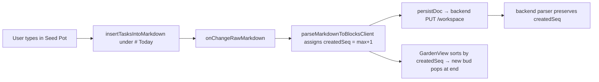

# Haru "Garden" Tab: Requirements & Implementation Plan

> Status: ready to implement · Author: planning session 2026-10-28 · Target: `haru/ui` (React 18 + Vite, no new deps)

## 1. Summary

Add a fourth view, **🌱 Garden**, to the Workspace view switcher (next to **Split View | Task Runner | Markdown**). It shows the same tasks in a cute way. Every task is a small original creature called a **Mochi Bud**. It's a round, squishy mochi/bean body with a sprout growing out of its head. The look borrows the *vibe* of Pikmin (little sprout-headed followers walking in a line) and Pusheen (chubby, soft, simple-faced, pastel). Buds appear **in the order the user added the tasks**, like a little parade.

On top of the parade there's a gentle **focus game** called **Garden Quest** (FR8):
- The first unfinished bud is the **Leader**, so you always know the one thing to do next.
- **Tend** a bud to start a focus timer (Pomodoro-style). The bud visibly grows while you work.
- Finishing tasks and focus time earns **☀ Sunshine**, which fills a daily goal ring and a gentle streak.
- Sunshine milestones unlock cute **companion pets**. These come from the open-source **Microsoft Fluent Emoji** set (MIT license, FR9). Your active companion cheers you on, and finished buds follow it like a little squad.

There are no punishments: buds never die or wilt from neglect, and the game can be switched off.

> [!IMPORTANT]
> **Original or properly licensed art only.** Do not copy Pikmin, Pusheen, or any other copyrighted character, and don't use their names in the UI.
> - Mochi Buds are our own characters, drawn as inline SVG in code.
> - Companion pets and decorations come **only** from the permissively licensed open-source sets in FR9. Copy them into the repo and bundle them. Never load them from a CDN at runtime, and don't load external fonts.

## 2. Goals / Non-goals

**Goals**
- G1: A cute, cozy, delightful view of the existing task list.
- G2: Tasks are shown in **creation order** (the order they were added), not document order.
- G3: The user can **add a task** directly from the Garden.
- G4: The user can complete, un-complete, run, and open the session for a task from the Garden.
- G5: Task state shows up as the character's look (idle / running / done / failed).
- G6: Works in both KiroCrew dark and light themes. Respects `prefers-reduced-motion`.
- G7: **Help the user focus.** Make "what's next" obvious (Leader), make starting easy (one-click Tend timer), and reward finishing (Sunshine, goal ring, companions).
- G8: **Kind game design.** Rewards only, never losses. No guilt nags, no exploits for farming points, and the user can turn it off.

**Non-goals**
- Changing how Split View, Task Runner, Markdown, Block Editor, Radar, or Connectors behave.
- Drag-to-reorder (creation order is fixed).
- External animation libraries (no framer-motion or lottie), webfonts, or loading images from a CDN at runtime. Sound is optional and off by default (FR8.10).
- Leaderboards, social features, paid items, or a spendable shop. Unlocks come from milestones, so you never lose anything you've earned.
- New backend endpoints. The only backend changes are one optional field on blocks (`createdSeq`) and an optional `garden` object stored by the existing `PUT /workspace` (§5.6).

## 3. Where it lives (current code map)

| Concern | File | Notes |
|---|---|---|
| View switcher (`split` / `interactive` / `editor`) | [SimpleInlineEditor.tsx](../ui/src/components/SimpleInlineEditor.tsx) L27, L149-L177, L181-L442 | Add `'garden'` to `ViewMode` and a 4th segment button. |
| Task actions / handlers | [App.tsx](../ui/src/App.tsx) | `handleToggleTask`, `handleRunSession`, `handleGoToSession`, `handleChangeAgent/Model`, `handleChangeRawMarkdown` are already passed into `SimpleInlineEditor`. |
| Agent/Model/Run controls | [TaskControlBar.tsx](../ui/src/components/TaskControlBar.tsx) | Reuse inside the expanded bud card. |
| Block model | [types/haru.ts](../ui/src/types/haru.ts) | Add the `createdSeq` field. |
| Client markdown parser | [localFallbackStore.ts](../ui/src/utils/localFallbackStore.ts) `parseMarkdownToBlocksClient` | Must preserve/assign `createdSeq`. |
| Server markdown parser | [store.mjs](../backend/store.mjs) `parseMarkdownIntoBlocks` (L42) | Must preserve/assign `createdSeq` the **same way**. |
| Styles | [haru-base.css](../ui/src/styles/haru-base.css), [haru-views.css](../ui/src/styles/haru-views.css) | Add a new `haru-garden.css` and include it in the `haruCss` concat in `App.tsx` (L27-L30). All selectors must be scoped under `.haru-shell .haru-garden`. |
| Helpers | [markdownHelpers.ts](../ui/src/utils/markdownHelpers.ts) | `cleanTaskBody`, `renderInlineMarkdown`. |
| Insert into section | [connectorHelpers.ts](../ui/src/utils/connectorHelpers.ts) `insertTasksIntoMarkdown` | Reuse for "plant a bud" so it goes under the target section. |

## 4. Functional requirements

### FR1: New Garden view
- FR1.1 Add a 4th button **"🌱 Garden"** to `.haru-view-segment` in `SimpleInlineEditor`. `ViewMode` becomes `'split' | 'interactive' | 'editor' | 'garden'`.
- FR1.2 When `viewMode === 'garden'`, render `<GardenView …/>` full width in place of both panes (`.haru-simple-workspace-body.mode-garden`).
- FR1.3 Remember the last view mode in `localStorage` key `haru.viewMode.v1` so the Garden stays selected after reload. Nice-to-have, but small.
- FR1.4 The existing toolbar quick-inserters (+ Task, + Numbered Task, + Section) stay hidden in Garden mode. Garden has its own add box (FR3).

### FR2: Creation-order display
- FR2.1 Show only **top-level tasks** (`type === 'task' && !isSubtask`) as buds. Sort them by `createdSeq` ascending.
- FR2.2 Show each bud's order number as a small badge (`#1`, `#2`, …). The number is its position in the sorted list, starting at 1. It is not the raw `createdSeq`.
- FR2.3 Completed tasks **keep their place** in the parade (order never changes). A toggle **"Hide bloomed 🌸"** (default off, saved in `haru.garden.hideDone.v1`) can hide them.
- FR2.4 Headers and notes are not shown. Each card shows its section as a small chip (e.g. `Today`, `Backlog`). This keeps the parade one continuous line.
- FR2.5 Subtasks show as **tiny baby buds** (about 40% size) trailing behind the parent. Show at most 3, then a `+N` chip. Baby buds use the same status visuals. Clicking a baby bud toggles that subtask.

### FR3: Plant (add) a task
- FR3.1 Put a cute input at the **end of the parade**: a "seed pot" card with the placeholder *"Plant a new bud… 🌱"* and a **Plant** button. Enter submits. Esc clears.
- FR3.2 On submit with non-empty trimmed text `t`, append the line `[] t` under the **target section** using `insertTasksIntoMarkdown(rawMarkdown, ['[] ' + t], target)`, then call `onChangeRawMarkdown(next)`.
  - The default target is the first header whose title contains `today` (case-insensitive). If there is none, append to the end of the document.
  - Optional: a small section `<select>` next to the input that lists existing headers.
- FR3.3 `@person` and `#tag` in the text work as usual, because the parser handles them.
- FR3.4 The new bud gets the next `createdSeq` (see §5), so it always shows up **last**. Play the "pop out of the soil" entrance animation (FR6) once for that bud only, and keep focus in the input so the user can plant several tasks quickly.
- FR3.5 Empty or whitespace input does nothing. The Plant button is disabled.

### FR4: Bud card interactions
Each bud is a card: `[#n badge] [Mochi Bud SVG] [title] [chips: section, @people, #tags] [status label]`.
- FR4.1 **Click the bud character** or its round checkbox to call `onToggleTask(id)`. When it becomes checked, play the bloom celebration (FR6).
- FR4.2 **Click the title** to edit inline (same pattern as `SimpleInlineEditor`'s `editingBlockId`: input, Enter/blur saves, Esc cancels). Saving reuses the existing `handleUpdateBlockContent` logic. Move it into a shared helper or pass it in as a prop.
- FR4.3 A **"⋯" / ⚙ button** expands the card to show `<TaskControlBar>` (agent, model, Run, Go to Session). Only one card is expanded at a time.
- FR4.4 Running tasks show a small **"🏃 working…"** label. If `session.slotKey` exists, the label is a link that calls `onGoToSession(block)`.
- FR4.5 Everything must work with the keyboard. The bud is a `<button>` with an `aria-label` like `"Task 3: Review PRs, not done. Press to mark complete"`. Show a visible focus ring.

### FR5: Header stats and empty state
- FR5.1 Garden header: title **"Haru Garden"** plus a count strip: `🌱 {idle} sprouting · 🏃 {running} working · 🌸 {done} bloomed`.
- FR5.2 A small progress vine/bar fills as `done / total`.
- FR5.3 Empty state (no top-level tasks): one big sleepy Mochi Bud (closed eyes, `z z` floating), the text *"Your garden is quiet. Plant your first task!"*, and the seed-pot input focused.
- FR5.4 All done (total > 0 and every task done): a happy cluster plus *"Everything bloomed! 🌸 Great job."*

### FR6: Character, states, and animation

**Mochi Bud anatomy** (one `MochiBud` component, inline SVG, `viewBox="0 0 100 100"`):
- **Body:** a soft rounded blob (wider than tall, slightly squished bottom), drawn with a single `<path>` or an ellipse plus a bottom ellipse. Pastel fill with a darker stroke of the same hue, about 3px.
- **Face:** two small dark oval eyes with tiny white highlights, pink blush ellipses (opacity ~0.6), and a tiny `ω` or `‿` mouth.
- **Little feet:** two small ovals at the bottom (used for the walking hop).
- **Sprout:** a stem from the top of the head. The tip changes with status:

| Status (`session.status` / `checked`) | Sprout tip | Face | Idle animation |
|---|---|---|---|
| Not done, idle | 🌱 single leaf | open eyes, blinks every ~4s (stagger by index) | gentle 2-3px breathing bob (`scaleY` 0.97↔1.0) |
| `running` | 🌿 bud (closed round bulb) | focused `> <` eyes + sweat drop | walking hop in place, 0.6s loop, plus tiny dust puffs |
| `checked === true` (done) | 🌸 open 5-petal flower | `^ ^` happy closed eyes, bigger blush | slow sway; card desaturated about 15%, still clearly readable |
| `failed` | wilted, drooping leaf | `@ @` / swirl dizzy eyes | small sad wobble |
| `completed` / `review_ready` but not checked | 🌼 bud with a peeking petal, plus an `!` speech bubble "ready for review" | sparkly eyes | gentle bounce |

`checked` wins over `session.status` when deciding the look.

**Color palette:** pick a body color by `createdSeq % 6` so each bud keeps its color forever:
`peach #FFC8A8`, `mint #BDEFD6`, `lavender #D9C8FF`, `butter #FFE9A8`, `sky #BFE3FF`, `sakura #FFC9DE`. The stroke is the same hue about 35% darker. In dark theme, keep the pastel bodies (they read well on dark) and darken only the card and background surfaces.

**Animations** (CSS keyframes only, all under `.haru-garden`):
- `bud-pop`: entrance for a newly planted bud. It starts at `translateY(20px) scale(0.3)`, overshoots to 1.1, then settles at 1. 450ms, spring-like `cubic-bezier(.34,1.56,.64,1)`. Draw a small soil mound under it.
- `bud-bloom`: on completion. A hop (translateY -14px), the sprout morphs to a flower (crossfade the leaf and flower groups), and 6-8 small petal particles burst outward and fade (absolutely positioned spans, ~700ms). Remove the particles after the animation ends.
- `bud-blink`, `bud-breathe`, `bud-walk`, `bud-sway`: loops. Stagger them with `animation-delay: calc(var(--i) * -0.37s)` so the buds don't move in sync.
- Hover over a card: the bud does a small squish (`scale(1.06, 0.94)`), and the card lifts with a soft shadow.
- `@media (prefers-reduced-motion: reduce)`: turn off all loops and particles. Keep instant state changes (sprout/face swap) and fades of 150ms or less.

**Parade layout:**
- A responsive CSS grid (`repeat(auto-fill, minmax(180px, 1fr))`, gap 16px). Cards flow left→right, top→bottom in creation order.
- A dashed "garden path" line runs behind the cards. A simple version is fine: a dashed bottom border per row, or a soft dotted background on the grid container. An exact path through each card is not required.
- Card: rounded 20px, padding 14px, pastel tint of the bud color (about 12% on the card surface), 2px border of the bud stroke at about 30%. The bud is about 72px, centered above the title.
- Narrow widths (<520px): switch to a single-column list with the bud at 48px on the left and text on the right.

### FR7: Cute theme tokens (scoped)
Define these on `.haru-shell .haru-garden`:
```css
--garden-bg: color-mix(in srgb, var(--haru-bg) 88%, #ffe9f1);   /* faint blush tint */
--garden-card: color-mix(in srgb, var(--haru-card) 85%, #fff6ea);
--garden-ink: var(--haru-text-strong);
--garden-muted: var(--haru-muted);
--garden-radius: 20px;
--garden-font: 'Nunito', 'Quicksand', 'Varela Round', var(--haru-font-sans); /* local fallbacks only, no fetch */
--garden-shadow: 0 6px 18px -8px rgba(255, 140, 170, .35);
```
- In dark theme (`[data-theme="dark"]` or the hosted dark mode), use a lower blush mix (~6%) so it doesn't look washed out.
- Buttons in Garden are pill-shaped (radius 999px). The primary Plant button uses the sakura gradient `#FF9EC0 → #FFB8A0` with dark ink text so contrast stays at 4.5:1 or better.
- Garden CSS **must not** change any styles outside `.haru-garden`.

### FR8: Garden Quest, the focus game

The game uses well-known focus techniques, made cute:
- **One thing at a time:** the Leader bud.
- **Timeboxing:** Tend sessions, Pomodoro-style.
- **Small, frequent rewards:** Sunshine, a bloom animation, and the companion cheering.
- **Gentle consistency:** a daily goal and a streak with a free "rain day".

The rules engine is a set of pure functions (`gameRules.ts`), so it's easy to test.

#### FR8.1 Leader bud ("do this next")
- The **first unfinished, top-level bud in parade order** is the **Leader**. It wears a tiny 🚩 flag (part of the SVG), its card has a soft glowing ring, and it's labeled **"Next up"**.
- The user can **pin** a different bud as Leader using "📌 Make leader" in the card menu. The pin is stored as `game.pinnedLeaderId`. It's cleared automatically when that task is done or deleted.
- The Garden header has a big **"🌱 Tend the leader"** button that starts a focus session (FR8.2) on the Leader.
- The other unfinished buds look slightly calmer (about 92% scale, no breathing loop) so the Leader stands out. They stay fully clickable.

#### FR8.2 Tend session (focus timer)
- Start from the header button (Leader) or from **"⏱ Tend"** on any unfinished bud card. Duration chips: **10 / 25 / 45 min**. The default is 25. The last choice is remembered in `game.focusMinutes`.
- Starting opens the **Focus overlay**, which covers the Garden pane only, not the KiroCrew host:
  - The tended bud is shown big (about 160px) in the center. Around it is a **circular timer ring** (SVG `stroke-dasharray`) showing `mm:ss` remaining, with the task title below.
  - **Growth stages:** the bud's sprout grows as time passes. It goes seed (0-25%), then sprout (25-50%), then leaf (50-75%), then bud (75-100%). When the session completes, the flower blooms.
  - The active companion (FR8.6) sits next to the bud with a "working" pose: a gentle bob and a speech bubble showing a random kind line every ~5 min, e.g. *"You've got this!"* or *"One leaf at a time 🌿"*.
  - Buttons:
    - **Pause / Resume**
    - **✅ I finished the task**: marks the task done, plays the bloom, and gives the task reward plus focus minutes so far.
    - **🌙 Stop for now**: ends early with no penalty. Minutes focused still count if they're 5 or more.
- **When the timer reaches zero:**
  - Show the bloom-ish "session complete" animation and give the focus reward.
  - Call `notify('Focus session complete! ☀ +N', 'success')`.
  - Ask: **"Did you finish the task?"** with the options *Yes, bloom it* / *Not yet, keep going*. Then offer a **5-minute break** ("☕ Take a break" with the companion napping and a break timer) or **"Back to garden"**.
- **Survives reloads and tab switches.** Persist `{ taskId, durationMs, startedAt, pausedAt?, pausedAccumMs, phase: 'focus' | 'break' }` in game state. Compute remaining time as `durationMs - (now - startedAt - pausedAccumMs)` (subtract the current pause too, if paused). Never count down by decrementing on each tick. Tick the UI every 1s with `setInterval`.
- Only **one** session at a time. If a session is active and the user leaves the Garden view, show a small floating pill `🌱 18:42 · Task title` on the Workspace toolbar. Clicking it returns to the overlay.
- In standalone mode only (`!isHosted`), prefix `document.title` with `🌱 mm:ss` while focusing. Never touch the host title.
- If the tended task is deleted from the markdown, end the session quietly and keep the minutes already earned.

#### FR8.3 ☀ Sunshine (points)
| Event | Reward | Rules |
|---|---|---|
| Top-level task becomes checked | **+10** | Once per task id, ever (`rewardedTaskIds`). Unchecking doesn't remove it. Re-checking doesn't award again. |
| Subtask becomes checked | **+3** | Same once-only rule. |
| Focus minutes | **+1 per full minute** | Only for sessions of 5+ minutes. |
| Completed full focus session (timer reached 0) | **+5 bonus** | |
| Daily goal met (FR8.4) | **+15 bonus** | Once per calendar day. |

- Detect checks in **any** view, including typing `[x]` in Markdown. Do this with a hook in `App.tsx` that compares the previous and next `doc.blocks` (FR8.8). On the very first load, put all already-checked task ids into `rewardedTaskIds` so old tasks don't pay out.
- Each reward shows a small floating `☀ +10` above the bud, plus a short "sun" pulse on the HUD counter.
- Sunshine is **lifetime-only** and is never spent or lost. `sunshineLifetime` drives levels (FR8.5) and unlocks (FR8.6).

#### FR8.4 Daily goal ring & gentle streak
- **Daily goal:** "Bloom **N** tasks today". The default N is 3, adjustable from 1 to 10 in the HUD popover. It's shown as a ring around a sun icon in the HUD (e.g. 2/3). Tasks count toward today when they are checked on today's **local** date (`completionLog`).
- When the goal is met: a confetti-of-petals burst on the HUD, *"Today's garden is happy! 🌸"*, and +15 ☀.
- **Streak:** the number of consecutive local days the daily goal was met, shown as `🌤 4-day streak` (best streak in the tooltip).
  - **Rain day:** one missed day per ISO week is forgiven automatically, so the streak continues. The tooltip says *"☔ A rain day kept your streak safe"*. A second missed day resets the streak to 0, with no scary messaging. The copy is just *"New streak starts today 🌱"*.
- Compute the streak lazily on load and whenever the date changes. No background jobs.

#### FR8.5 Garden level
- The level comes from `sunshineLifetime` with thresholds `[0, 30, 80, 150, 250, 400, 600, 850, 1150, 1500]`, so levels go from 1 to 10 (cap at 10, show "Lv 10 ✨" after that). The HUD shows `Lv 3` and a thin bar of progress to the next level.
- On level-up: a small banner *"Garden grew to Lv 4! 🌳"*. If that level unlocks a companion or decoration, say so.

#### FR8.6 Companions (cute open-source pets)
- Companions unlock at **lifetime-Sunshine milestones**. There's no buying. The user picks one **active** companion in the companion picker (HUD → 🐾).

| Id | Name in UI | Unlock at ☀ | Fluent Emoji asset folder (Flat) |
|---|---|---|---|
| `chick` | Pip the chick | 0 (starter) | `Hatching chick` |
| `bee` | Bumble | 30 | `Honeybee` |
| `rabbit` | Mochi Bun | 80 | `Rabbit face` |
| `cat` | Biscuit | 150 | `Cat face` |
| `frog` | Lily | 250 | `Frog` |
| `penguin` | Waddle | 400 | `Penguin` |
| `bear` | Honey | 600 | `Bear` |
| `unicorn` | Sparkle | 1000 | `Unicorn` |

- **Where the companion appears and what it does:**
  - In the Garden header, beside the stats. It reacts with CSS-only animations applied to the image wrapper:
    - idle: a gentle bob
    - a task blooms: a hop plus a ♥ pop
    - Tend session running: a "working" sway
    - break: a nap, shown as tilted with `z z` overlaid
    - goal met: a spin hop
  - **Squad trail (the Pikmin-like moment):** buds completed **today** line up behind the companion in the header as tiny 22px Mochi Buds (in flower state) following in single file. Show up to 8, then `+N`. When a bud blooms, it hops from its card position into the trail. A simple version is fine: fade in at the end of the trail.
- Locked companions show as grey silhouettes (`filter: grayscale(1) brightness(0.6)`) with "Unlocks at ☀ 150".
- When a companion unlocks: a modal-lite card *"New friend! Biscuit joined your garden 🐱"* with a **Make active** button.

#### FR8.7 Garden decorations (P2, optional stretch)
- Extra levels unlock decorations: `Sunflower`, `Mushroom`, `Tulip`, `Four leaf clover`, `Rainbow` (Fluent Emoji, Flat). They appear at fixed spots along the garden path background. They're purely visual, with no interaction. Ship this only after FR8.1-FR8.6 are done.

#### FR8.8 Where game logic runs
- Put a `useGardenGame(doc, { notify, isHosted })` hook in `App.tsx`, so rewards fire no matter which view the user edits in. It returns `{ game, actions }`, which are passed down to `SimpleInlineEditor` → `GardenView`.
- `actions`: `startFocus(taskId, minutes)`, `pauseFocus()`, `resumeFocus()`, `finishFocus(markDone: boolean)`, `stopFocus()`, `startBreak()`, `endBreak()`, `setDailyGoal(n)`, `setActiveCompanion(id)`, `pinLeader(taskId | null)`, `setEnabled(bool)`, `dismissUnlock(id)`.
- All reward math lives in **pure functions** in `gameRules.ts`. They take state and inputs and return the next state plus events, with no React or `Date.now()` inside: pass `now` in. This makes them testable with `node --test`.

#### FR8.9 Game on/off & kindness rules
- A **"🎮 Garden Quest"** toggle sits in the Garden header menu. It defaults to **on** and is stored in `game.enabled`. When off, hide the HUD, Leader flag, Tend buttons, companions, and reward pops. The parade, planting, and toggling still work. Rewards are still recorded quietly so the user doesn't lose progress when they turn it back on. **Decision: record silently.**
- **Never:**
  - kill, wilt, or sadden buds because time passed (the `failed` look is only for real agent session failures)
  - show red "you missed" messaging
  - push notifications other than the session-complete toast
  - award points for un-check/re-check cycles
- All copy must be supportive and short.

#### FR8.10 Sound (optional, default off)
- If implemented, use a tiny WebAudio "pling" synthesized in code (no audio files) on bloom and session complete. The toggle is in the game menu. It defaults to **off**. Skip it entirely if time is short.

### FR9: Open-source character & art assets

- **FR9.1 Primary source: Microsoft Fluent Emoji, Flat style SVGs.** Repo: https://github.com/microsoft/fluentui-emoji, **MIT License** (Copyright (c) Microsoft Corporation). It's cute, consistent, and comes in pastel-friendly flat vectors. It's also allowed for commercial use and modification as long as the license notice is kept.
  - Path pattern: `assets/<Folder Name>/Flat/<folder_name_snake>_flat.svg`. Example: `assets/Cat face/Flat/cat_face_flat.svg`. Raw download: `https://raw.githubusercontent.com/microsoft/fluentui-emoji/main/assets/Cat%20face/Flat/cat_face_flat.svg`.
  - The implementer **must check every filename against the repo** (a few use slightly different names) and download them **once**, at dev time.
- **FR9.2 Vendoring.** Commit the SVGs to `haru/ui/src/assets/fluent/` with snake_case names (e.g. `cat_face.svg`). Import them with Vite `?raw` and render via ``. That way they're inlined into the single `.mjs` bundle and no network is needed at runtime. Only include the files we use, about 13 for companions and decorations, each typically 2-10 KB.
- **FR9.3 Attribution.**
  - Add `haru/THIRD_PARTY_NOTICES.md` with the full Fluent Emoji MIT license text and a list of the files used.
  - Copy the license to `haru/ui/src/assets/fluent/LICENSE`.
  - Add a small "Art credits" link in the companion picker footer that opens a tiny credits popover.
- **FR9.4 Allowed alternatives**, if a needed character is missing:
  - **Google Noto Emoji** (Apache-2.0, https://github.com/googlefonts/noto-emoji, `svg/emoji_u1f431.svg`)
  - **Kenney** assets (CC0, https://kenney.nl). Pixel/toon style; use only if we switch to a pixel theme.
  - Don't mix styles within the companion set.
- **FR9.5 Avoid:**
  - **OpenMoji** (CC BY-SA 4.0, whose share-alike terms could reach our bundle)
  - **Twemoji** graphics (CC BY 4.0). This one is acceptable only with visible attribution; prefer Fluent.
  - Any fan art, Pikmin/Pusheen/Nintendo/Sanrio assets, or "free download" sites without a clear license.
- **FR9.6** The Mochi Bud remains the **task** character (original SVG). Fluent Emoji is used only for **companions and decorations**, so tasks keep a unified, ownable look.

## 5. Data model change: `createdSeq`

The current parser matches tasks by text and sometimes regenerates IDs. Document order changes when users insert lines in the middle. So creation order needs its own stable counter.

- 5.1 In `HaruBlock` ([types/haru.ts](../ui/src/types/haru.ts)), add:
  ```ts
  createdSeq?: number;   // monotonically increasing; assigned once when a task is first seen
  createdAt?: string;    // ISO, informational
  ```
- 5.2 In **both** parsers (`parseMarkdownToBlocksClient` and backend `parseMarkdownIntoBlocks`):
  - Before mapping, compute `let nextSeq = max(existingBlocks.createdSeq ?? 0) + 1`.
  - For a task line, if the block matched an existing task (the same `matched` logic as today) and that task has `createdSeq`, **reuse** it (and `createdAt`).
  - Otherwise assign `createdSeq = nextSeq++` and `createdAt = new Date().toISOString()`.
  - **Migration:** if *no* existing block has `createdSeq` (old data), assign seqs in document order. Then the first load matches today's order.
- 5.3 Headers and notes don't need `createdSeq`.
- 5.4 `handleToggleTask` and the other App handlers already call the parser with `prev.blocks`, so seqs carry through. Check that `handleResetDemo` and `createDefaultState` produce seqs 1..N.
- 5.5 Known limitation (already true for `session`): if the user rewrites a task's text in the raw Markdown pane *and* moves it to another line in the same edit, it may be treated as a new task and get a new seq. This is acceptable, and the doc should mention it.

### 5.6 Game state (`GardenGameState`)
This is stored **separately from the markdown doc**, so game data never ends up in `workspace.md`.
```ts
// ui/src/components/garden/game/gameTypes.ts
export interface GardenGameState {
  version: 1;
  enabled: boolean;                       // FR8.9
  sunshineLifetime: number;               // FR8.3, never decreases
  rewardedTaskIds: string[];              // once-only rewards (cap 2000, drop oldest)
  completionLog: Array<{ taskId: string; date: string /* YYYY-MM-DD local */; at: string }>; // keep 60 days
  focusLog: Array<{ taskId: string; date: string; minutes: number; full: boolean }>;       // keep 60 days
  dailyGoal: number;                      // 1..10, default 3
  goalRewardedDates: string[];            // dates the +15 was paid (keep 60)
  streak: { current: number; best: number; lastGoalDate?: string; rainDayWeeks: string[] /* ISO weeks used */ };
  focusMinutes: 10 | 25 | 45;             // last chosen duration
  focus?: { taskId: string; phase: 'focus' | 'break'; durationMs: number; startedAt: number; pausedAt?: number; pausedAccumMs: number };
  activeCompanion: string;                // default 'chick'
  unlockedCompanions: string[];           // derived from sunshine, stored for "new friend" detection
  seenUnlocks: string[];                  // unlock modals already shown
  pinnedLeaderId?: string;                // FR8.1
  soundOn: boolean;                       // FR8.10, default false
  initialized: boolean;                   // false until first-load seeding of rewardedTaskIds (FR8.3)
}
```
- **Persistence:**
  - Always save to `localStorage['haru.garden.game.v1']` first.
  - Then debounce (1s) a write of `api.put('/apps/haru/api/workspace', { garden: state })`.
- **Backend change (small):**
  - In [server.mjs](../backend/server.mjs) `PUT /workspace`, add `if (body.garden && typeof body.garden === 'object') store.garden = body.garden;`.
  - `GET /workspace` already spreads `...store`, so `garden` comes back without changes. `POST /workspace/reset` should **keep** `store.garden`: resetting tasks must not wipe progress.
- **Load priority:** use whichever copy has the larger `sunshineLifetime`, backend or local. Merge `rewardedTaskIds` as a union.
- Validate on load, clamp values, and fill defaults. A corrupt object resets to defaults, logs a warning, and never crashes the UI.

## 6. Component plan

```
ui/src/components/garden/
  GardenView.tsx       // header + stats, hide-done toggle, parade grid, seed pot, empty states
  BudCard.tsx          // one task card (badge, MochiBud, title edit, chips, expand → TaskControlBar, baby buds)
  MochiBud.tsx         // pure SVG character: props { status: 'idle'|'running'|'done'|'failed'|'review'|'sleepy', colorIndex: number, size?: number, celebrate?: boolean }
  SeedPot.tsx          // add-task input card
  gardenUtils.ts       // getBudStatus(block), sortByCreation(blocks), palette, findDefaultTargetSection(doc)
  FocusOverlay.tsx     // FR8.2 timer ring, growth stages, companion, controls, break mode
  FocusPill.tsx        // FR8.2 floating "🌱 18:42" pill when away from Garden
  GameHud.tsx          // FR8.3-8.5 sunshine counter, goal ring, streak, level bar, menu (game on/off, sound, goal)
  CompanionSprite.tsx  // FR8.6 renders a vendored Fluent SVG with mood classes
  CompanionPicker.tsx  // FR8.6 grid of companions (locked silhouettes), art credits
  SquadTrail.tsx       // FR8.6 today's bloomed buds following the companion
  RewardPop.tsx        // floating "☀ +10"
  game/
    gameTypes.ts       // GardenGameState + event types
    gameRules.ts       // PURE: applyTaskChecks, applyFocusEnd, computeStreak, levelFor, unlockedFor, getLeader, remainingMs
    companions.ts      // registry: id, name, unlockAt, svg raw import
    useGardenGame.ts   // React hook: load/merge/persist, diff doc.blocks → rewards, timer tick, actions
    gameRules.test.ts  // optional: node --test with type stripping (Node ≥ 22.18 / 23.6); skip if unavailable
ui/src/assets/fluent/  // vendored MIT SVGs + LICENSE (FR9)
haru/THIRD_PARTY_NOTICES.md
ui/src/styles/haru-garden.css
```

`GardenView` props (everything comes from `SimpleInlineEditor`, which already has these from `App`):
```ts
interface GardenViewProps {
  doc: HaruDocument;
  agents: KiroAgentOption[];
  models: KiroModelOption[];
  onChangeRawMarkdown: (md: string) => void;
  onToggleTask: (id: string) => void;
  onUpdateBlockContent: (id: string, text: string) => void; // lifted from SimpleInlineEditor
  onChangeAgent: (id: string, agent: string) => void;
  onChangeModel: (id: string, model: string) => void;
  onRunSession: (b: HaruBlock) => void;
  onGoToSession: (b: HaruBlock) => void;
  game: GardenGameState;            // FR8, from useGardenGame in App.tsx
  gameActions: GardenGameActions;   // FR8.8
  now: number;                      // ticking clock from useGardenGame (1s while focusing, 30s otherwise)
}
```

Animation triggers:
- **New bud pop:** `GardenView` keeps a `useRef<Set<string>>` of IDs it has already seen. On render, IDs not in the set get the class `is-new`, then get added to the set. On first mount, seed the set with every current ID so existing buds don't all pop at once.
- **Bloom:** `BudCard` keeps track of the previous `checked` value (`useRef`). When it goes from false to true, set `celebrate = true` for about 800ms.

## 7. Flow



## 8. Acceptance criteria

1. The Workspace segment shows **Split View | Task Runner | Markdown | 🌱 Garden**. Clicking Garden shows the garden full width. The other three modes are unchanged.
2. Adding tasks A, B, C from the Garden shows them as #1 A, #2 B, #3 C (after any existing tasks), with C last. This holds after reload (localStorage and backend).
3. Adding task D in the Markdown pane *above* A in the document still shows D **after** C in the Garden.
4. Checking a bud turns it into the 🌸 flower state with the bloom animation, and it keeps its position. The Markdown pane shows `[x]`.
5. Clicking Run from the expanded card starts a KiroCrew session (same behavior as Task Runner). The bud switches to the running/walking look, and the "working…" label links to the session.
6. Subtasks show as baby buds, and toggling one updates the markdown.
7. "Hide bloomed" hides completed buds, and the setting persists.
8. Empty state and all-done state render as described.
9. With OS reduced-motion on, nothing loops or bursts.
10. It looks good in both standalone light and dark themes and inside KiroCrew. No Garden styles leak outside `.haru-garden`.
11. `npm run build` passes `tsc -b` with no new dependencies added to `package.json`.
12. Old saved workspaces (no `createdSeq`) load without errors, and the Garden order equals the document order.

**Garden Quest (FR8 / FR9)**

13. **Leader:** the first unfinished bud in parade order has the 🚩 flag and the "Next up" label. Completing it moves the flag to the next unfinished bud. Pinning another bud overrides this until that task is done.
14. **Tend:** starting a 10-minute session shows the overlay with a counting-down ring and growth stages. Reloading the page mid-session restores the overlay with the correct remaining time (±1s). Pause freezes the time, and resume continues it.
15. **Rewards:**
    - Checking a never-rewarded task gives ☀ +10 exactly once. Un-checking and re-checking gives nothing.
    - Typing `[x]` in the Markdown pane also gives the reward.
    - Tasks that were already checked before the first load give nothing.
    - A full 10-minute session gives +10 (minutes) and +5 (bonus). Stopping at 3 minutes gives 0, and stopping at 7 minutes gives +7.
16. **Daily goal:** with the goal at 2, blooming 2 tasks today fills the ring, shows the celebration, and gives +15 once. A third bloom doesn't pay the bonus again.
17. **Streak:** testing with an injected `now` in `gameRules`, goals met on Mon, Tue, (miss Wed), Thu give streak 3, using a rain day. A second miss in the same ISO week resets the streak to 0, then it becomes 1 once the goal is met.
18. **Companions:**
    - The chick is active by default.
    - Crossing ☀ 30 shows the "New friend! Bumble" card once.
    - Locked companions render as silhouettes.
    - The active choice persists. Completed-today buds appear in the squad trail.
19. **Persistence:** game state survives a reload from localStorage and also from the backend (clear localStorage, then reload). "Reset Tasks" does **not** reset Sunshine, the streak, or companions.
20. **Game off:** turning Garden Quest off hides the HUD, Leader, Tend, and companions. The basic parade still works. Turning it back on shows the progress kept (including rewards earned while it was off).
21. **Assets:**
    - All companion images come from vendored Fluent Emoji SVGs under `ui/src/assets/fluent/`.
    - The DevTools Network tab shows **no** external image or font requests.
    - `THIRD_PARTY_NOTICES.md` and the in-app Art credits exist.
22. **Kindness:** no code path makes a bud sad or wilted because time passed. The `failed` look only appears when `session.status === 'failed'`.

## 9. Implementation steps (suggested order)

1. Data: add `createdSeq`/`createdAt` to types. Update the client parser and the backend parser (`store.mjs`) plus migration. Check that existing views still work.
2. `MochiBud.tsx`: build the SVG with all 6 states. Optionally add a temporary preview grid in dev mode (`npm run dev` in `ui/`, standalone) to tune the look.
3. `gardenUtils.ts` + `SeedPot.tsx` + `GardenView.tsx` with the static layout.
4. `BudCard.tsx`: toggle, inline edit, expand to `TaskControlBar`, baby buds.
5. `haru-garden.css`: tokens, layout, keyframes, reduced-motion, narrow layout. Add it to the CSS concat in `App.tsx`.
6. Wire into `SimpleInlineEditor`: add the 4th segment, `mode-garden`, lift `handleUpdateBlockContent` into a prop, and persist the view mode.
7. **Game rules:** add `gameTypes.ts` + `gameRules.ts` (pure functions) and optional tests. Add `useGardenGame.ts` in `App.tsx`, plus the backend `garden` field in `PUT /workspace`.
8. **Assets:** vendor the Fluent Emoji SVGs, then add `companions.ts`, `CompanionSprite.tsx`, `THIRD_PARTY_NOTICES.md`, and the license.
9. **Game UI:** `GameHud`, Leader flag/ring in `BudCard`/`MochiBud`, `FocusOverlay` + `FocusPill`, `CompanionPicker`, `SquadTrail`, `RewardPop`.
10. Run through all acceptance criteria (1-22) in standalone (light/dark) and in KiroCrew (`npm run build` syncs).
11. Update [README.md](../README.md) with a short description of the Garden view and Garden Quest.

## 10. Open questions (defaults chosen; change if desired)

| # | Question | Default in this doc |
|---|---|---|
| Q1 | Tab name: "Garden", "Buddies", or "Parade"? | **🌱 Garden** |
| Q2 | Should completed buds stay in line or move to a "flower bed" at the bottom? | Stay in line (order matters), with an optional hide toggle |
| Q3 | Where do planted tasks go in the markdown? | First `# Today…` section, else the end of the doc |
| Q4 | Show headers/sections as separators in the parade? | No, section shows as a chip only |
| Q5 | Should Garden also be a top-level tab (beside Workspace/Radar/Connectors)? | No, it's a 4th Workspace view mode, as requested |
| Q6 | Focus durations? | 10 / 25 / 45 min plus a 5-min break |
| Q7 | Spendable shop vs milestone unlocks? | Milestone unlocks (nothing can be lost) |
| Q8 | Companion art source? | Microsoft Fluent Emoji Flat (MIT). Noto Emoji (Apache-2.0) as fallback |
| Q9 | Sound? | Optional, off by default (FR8.10) |
| Q10 | Should agent-completed sessions (`completed`) auto-award Sunshine? | No. Only the user checking the task awards it, which keeps the user in the loop |
