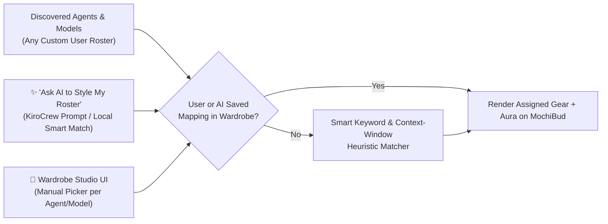

# Haru Garden v2: Lively Characters, Wardrobe Studio, Priority & Terrarium Plan

> Status: Ready for Implementation · Extends [`garden-tab-requirements.md`](./garden-tab-requirements.md) & [`garden-implementation-plan.md`](./garden-implementation-plan.md) · Target: `haru/ui` & `haru/backend`

---

## 1. Root-Cause Analysis & User Feedback Summary

| Area | Current Behavior / Issue | V2 Target Design |
|---|---|---|
| **1. Disappearing Garden Quest Settings** | In `GardenView.tsx`, `{game.enabled && <GameHud />}` unmounts the entire HUD (including the `⚙` settings gear button) the moment the user toggles Garden Quest `OFF`. There is no way to turn it back on without clearing storage. Also, the settings popover lacks an outside-click backdrop. | **Always-Mounted Header Bar**: Never unmount `<GameHud>`. When `game.enabled === false`, render a compact `🎮 Quest: Off` pill + `⚙` button so users can re-enable or configure settings at any time. Add a click-outside backdrop to close the popover cleanly. |
| **2. Hidden Run, Agent & Model Controls** | Agent, Model, and `▶ Run` are hidden behind a small `⚙` expand button on each `BudCard`. Users cannot see which agent/model is assigned or run a task with one click. | **Inline Card Action Bar**: Show compact, readable **Agent Pill**, **Model Pill**, and a prominent **`▶ Run`** button directly on the bottom of every `BudCard`. Changing either dropdown immediately updates the character's outfit and aura on the card. |
| **3. Static-Feeling Characters** | Mochi Buds currently use a gentle `2%` vertical scale breathing loop in place, which feels like a static picture compared to Pikmin or Pusheen. | **Living Character State Machine & Motion**: Mochi Buds continuously cycle through autonomous life behaviors (`waddle`, `sit`, `nap-bubble`, `look-around`, `stretch`, `happy-hop`) with articulated limbs, blinking/tracking eyes, and a full leaning **Pikmin Sprint Dash** (`running`) with pedaling feet, swinging tools, and dust clouds. |
| **4. Dynamic Agent & Model Outfits (User-Configurable + AI Auto-Stylist)** | Users in KiroCrew can have **any number of custom agents and models** (not just a hardcoded list). Hardcoding 4–5 IDs leaves custom agents/models unstyled. | **Character Wardrobe Studio + Heuristic & AI Auto-Stylist**: Provide a rich catalog of **8 Role Outfits (Agent Gear)** and **8 Power Auras/Crowns (Model Tiers)**. Smart keyword/capability heuristics automatically assign fitting gear to *any* discovered agent or model, **plus** a **👗 Wardrobe Studio** modal where users can manually customize any agent/model's look or click **✨ Ask AI to Style My Roster** to let KiroCrew AI assign outfits to all installed agents/models. |
| **5. Task Prioritization** | Tasks only support creation order (`createdSeq`). Users cannot mark urgent blockers or bring high-priority tasks to the front. | **4-Tier Priority System (`🔥 Urgent`, `⭐ High`, `🌿 Normal`, `💤 Low`)**: Synced bidirectionally with markdown tags (`#urgent`/`#p1`, `#high`/`#p2`, `#low`/`#p4`). One-click priority badge on each card + **Parade Sorter Toggle** (`🌱 Added Order` vs `🔥 Priority First`). |
| **6. Unique Signature Feature** | Needs something magical that no other task extension has. | **Living Garden Terrarium & Squad Cheer**: Interactive weather/atmosphere switcher (`☀️ Sunny Breeze`, `🌸 Sakura Rain`, `🌙 Starlight Fireflies`), clickable garden soil that sprouts wild daisies/clovers/mushrooms, and **Squad Expedition Cheer** where nearby buds turn and wave pom-poms whenever a task is actively running. |

---

## 2. Detailed Feature Specifications

### 2.1 Dynamic Agent & Model Wardrobe System (Custom Roster + AI Stylist)

Because KiroCrew dynamically discovers user-installed agents (`/api/agents`, `/api/agents/catalog`) and provider models (`/api/models`, `model_windows.json`), Haru Garden v2 decouples **Visual Cosmetics** from hardcoded IDs using a 3-layer resolution system:



#### A. Catalog of Agent Gear (8 Role Outfits + Held Items)
Each Agent maps to an `AgentGearId` that equips a **Hat/Headpiece** + **Held Tool** on the Mochi Bud:
1. `worker` (**👷 Builder**): Yellow construction hardhat + golden wrench (held in right hand, swings when running).
2. `research` (**🔬 Scholar**): Round brass magnifying spectacles + rolled ancient scroll / magnifying glass.
3. `conductor` (**🎩 Maestro**): Starry conductor peaked cap + glowing maestro baton.
4. `executor` (**🏃 Sprinter**): Red anime-style speed headband with fluttering tails + checklist clipboard.
5. `coder` (**🎧 Hacker**): Cozy over-ear headphones + tiny glowing laptop/keyboard charm.
6. `reviewer` (**🕵️ Detective**): Detective deerstalker cap + green check/shield badge.
7. `creative` (**🎨 Artist**): Pastel beret + paintbrush with rainbow paint dab.
8. `explorer` (**🎒 Explorer** — Default fallback): Leaf scout bandana + acorn backpack pouch.

#### B. Catalog of Model Prestige Tiers & Auras (8 Visual Styles)
Each Model maps to a `ModelStyleId` that equips a **Crown/Visor** + **Animated Background Aura** + **Sprout Evolution**:
1. `celestial` (**👑 Royal Celestial** — Frontier / 200K–1M+ / Opus / Sonnet): Floating golden star crown + orbiting purple/gold starlight particles.
2. `cyber` (**🥽 Cyber Matrix** — Reasoning / DeepSeek / o1 / R1): Glowing neon cyan visor over eyes + rising digital diamond sparks.
3. `shinobi` (**🥷 Blade Chakra** — Coding specialists / Qwen Coder / Codestral): Crimson ninja forehead protector + wind-swirl aura.
4. `dragon` (**🐉 Mystic Horns** — High-speed / MiniMax / GLM / Kimi): Cute pastel dragon horns + floating ember wisps.
5. `prism` (**🌈 Prismatic Auto** — `auto` / router): Iridescent crystal gem on sprout + soft rainbow halo ring.
6. `solar` (**☀️ Solar Flare** — Large general models): Sunny halo ring + warm golden glow.
7. `breeze` (**🍃 Mint Breeze** — Lightweight / Haiku / Flash): Feathered wing clips + fast mint speed lines.
8. `classic` (**🌱 Pure Sprout** — Minimal fallback): Classic clean Mochi Bud.

#### C. 3-Layer Resolution & The "👗 Wardrobe Studio" Modal
1. **Layer 1 — Smart Heuristic Matcher (Zero-Config Default)**:
   - For **Agents**: Inspects `agent.id`, `agent.name`, and `agent.description` for keywords (`worker|build|exec`, `research|search|doc`, `conduct|orchestrat|plan`, `code|dev|eng`, `review|qa|test|audit`, `design|art|ui`), falling back to deterministic hash across the 8 outfits so every custom agent looks distinct out of the box.
   - For **Models**: Inspects `model.id`, `model.label`, `model.provider`, and context window (`1M`/`256K`/`200K`) to automatically assign the matching prestige tier (`celestial` for Opus/Sonnet/1M+, `cyber` for DeepSeek/reasoning, `shinobi` for Coder models, `breeze` for Haiku/Flash/Lite, `prism` for `auto`).
2. **Layer 2 — Manual Customization in "👗 Wardrobe Studio" (`WardrobeModal.tsx`)**:
   - Accessible via a **"👗 Wardrobe"** button in the Garden Header.
   - Lists all currently available **Agents** (left tab) and **Models** (right tab) discovered from KiroCrew.
   - Shows a live animated `<MochiBud>` preview for each item and lets the user click to pick any of the 8 Outfits (for agents) or 8 Auras/Crowns (for models).
   - Saved in `game.wardrobe: { agentGear: Record<string, AgentGearId>; modelStyle: Record<string, ModelStyleId> }`.
3. **Layer 3 — "✨ Auto-Style with AI" Button**:
   - Inside the Wardrobe Studio, clicking **"✨ Auto-Style Roster with AI"** analyzes the names, descriptions, and capabilities of all installed agents and models (via KiroCrew chat/API or instant smart semantic analyzer fallback) and assigns a cohesive, varied set of outfits and auras across the entire roster with a celebratory sparkle effect.

---

### 2.2 Lively, Motion-Rich Mochi Bud Animations (Pikmin-Inspired)

To make Mochi Buds feel **alive** rather than static icons, `MochiBud.tsx` and `haru-garden.css` will implement:

1. **Articulated SVG Parts**:
   - Separate `<g>` groups for `.mochi-shadow`, `.mochi-foot-left`, `.mochi-foot-right`, `.mochi-body-group`, `.mochi-arm-left`, `.mochi-arm-right` (with held Agent tool), `.mochi-eyes-group`, `.mochi-sprout`, and `.mochi-aura`.
2. **Autonomous Idle Pose Cycle (for `status === 'idle'`)**:
   - Instead of every idle bud doing the exact same bob, each bud cycles through living behaviors based on `(staggerIndex + Math.floor(now / 12000)) % 4`:
     - **Pose A — `waddle` (Walking in place)**: Alternating left/right foot steps, body tilting `-4deg ↔ +4deg`, arms swinging gently.
     - **Pose B — `sit` (Sitting down Pikmin-style)**: Body lowers onto the soil, little feet stick out in front (`rx="8" ry="5"`), head tilts curiosly with slow happy blinks.
     - **Pose C — `look` (Curious look-around)**: Eyes and sprout shift left, then right, then hop once in excitement.
     - **Pose D — `daydream` (Cozy rest)**: Half-closed relaxed eyes, gentle swaying leaf, tiny floating musical note `♪` or bubble.
3. **Full "Pikmin Sprint" Running Animation (`status === 'running'`)**:
   - Body leans forward (`rotate(10deg)`), fast alternating foot pedaling (`0.22s` cycle), held Agent tool waves actively, sweat drops fly backward, and animated multi-puff dust clouds trail behind the feet.
4. **Interactive Hover & Boop Physics**:
   - Hovering over a card makes the Mochi Bud perk up, wave its tool/hand, and look toward the cursor.
   - Clicking/poking triggers a jelly squash-and-stretch (`scale(1.22, 0.74)` → `scale(0.92, 1.12)` → `1`), floating hearts, and an agent-themed sound chime.

---

### 2.3 Visible & Simple Card Controls (Agent, Model, Priority, Run)

Redesign `BudCard.tsx` so essential actions are **immediately visible** without opening a hidden drawer, while keeping the card airy and uncluttered:

```
┌──────────────────────────────────────────────────────┐
│ #1 🔥 Urgent              🚩 Next up   ⏱  📌        │ ← Top bar: Order, Priority pill, Focus, Pin
│                                                      │
│                   👑 (Model Crown)                   │
│                 ╭───────╮                            │
│                 │ ^ ω ^ │🔧 (Agent Tool)            │ ← Living MochiBud (88px) with Aura & Gear
│                 ╰───┬───╯                            │
│                   ░░░░░  ✓                           │
│                                                      │
│   Review open pull requests @Aziz #code-review       │ ← Inline-editable task title + #Section chip
│   [👶][👶] 2 subtasks                                │ ← Baby buds row (if subtasks exist)
│ ──────────────────────────────────────────────────── │
│  [👷 worker ▾] [👑 claude-4.5 ▾]        [ ▶ Run ]   │ ← Always-visible compact footer bar!
└──────────────────────────────────────────────────────┘
```

- **Compact Footer Pills**:
  - `<select className="haru-garden-compact-select">` for Agent and Model styled as soft pastel pills (`max-width: 108px`, ellipsis overflow) showing the outfit/aura emoji prefix.
  - Prominent **`▶ Run`** pill button on the right (switches to **`🏃 Working… ↗`** when running, or **`↻ Run`** when completed).
  - The old `⚙` expand button and secondary drawer are no longer needed because all controls fit cleanly in the footer!

---

### 2.4 Task Prioritization System

1. **4 Priority Levels**:
   - `urgent` (**🔥 Urgent** — `#urgent` or `#p1` in markdown)
   - `high` (**⭐ High** — `#high` or `#p2` in markdown)
   - `normal` (**🌿 Normal** — default, no tag needed)
   - `low` (**💤 Low** — `#low` or `#p4` in markdown)
2. **One-Click Priority Cycling on Card**:
   - Clicking the priority badge in the top-left of any `BudCard` cycles `normal → high → urgent → low → normal` by updating the task line's `#urgent` / `#high` / `#low` tag in `rawMarkdown` (so priority is 100% persisted in Markdown and visible across Split View, Task Runner, and Radar!).
3. **Parade Sort Mode Toggle in Garden Header**:
   - Segmented pill in the header: **`🌱 Added Order`** (default `createdSeq` parade) vs **`🔥 Priority First`** (sorts `urgent` → `high` → `normal` → `low`, breaking ties by `createdSeq`, and automatically makes the highest-priority unfinished task the **🚩 Leader** unless another task is manually pinned).

---

### 2.5 Unique Signature Feature: "The Living Terrarium"

1. **Atmosphere / Weather Switcher (`☀️ Sunny` | `🌸 Sakura` | `🌙 Night`)**:
   - Pill toggle in the Garden header persisted in `game.atmosphere`:
     - **☀️ Sunny Breeze**: Warm golden sunlight gradient at the top of the garden + floating golden pollen motes and a fluttering butterfly SVG that visits cards.
     - **🌸 Sakura Rain**: Soft pink sky tint + 12 CSS-animated cherry blossom petals gently drifting and swaying across the garden.
     - **🌙 Starlight Night**: Cozy twilight indigo backdrop + glowing yellow-green fireflies drifting around the buds and soft lantern glow on the Leader card.
2. **Interactive Garden Soil (Click-to-Sprout Wildflowers)**:
   - Clicking empty space on the `.haru-garden-parade` path plants a tiny decorative wildflower, 4-leaf clover, or cute mushroom at that spot (up to 12 decorations, with a gentle pop sound).
3. **Pikmin Squad Cheer When a Task is Running**:
   - Whenever any task has `status === 'running'`, neighboring idle buds display a tiny cheering speech bubble (`"Go! 🚩"`, `"✨"`, `"💪"`) and bounce in support.

---

## 3. Step-by-Step Implementation Plan

### Phase 1: Fix HUD Unmount Bug & Extend Game State (`gameTypes.ts`, `GameHud.tsx`, `GardenView.tsx`)
- **Files**:
  - `haru/ui/src/components/garden/game/gameTypes.ts`
  - `haru/ui/src/components/garden/game/useGardenGame.ts`
  - `haru/ui/src/components/garden/GameHud.tsx`
  - `haru/ui/src/components/garden/GardenView.tsx`
- **Steps**:
  1. Add `wardrobe: { agentGear: Record<string, AgentGearId>; modelStyle: Record<string, ModelStyleId> }`, `sortBy: 'added' | 'priority'`, and `atmosphere: 'sunny' | 'sakura' | 'night'` to `GardenGameState` and `createDefaultGameState()`.
  2. Add actions `setAgentGear(agentId, gearId)`, `setModelStyle(modelId, styleId)`, `autoStyleRoster(agents, models)`, `setSortBy(mode)`, and `setAtmosphere(atm)` to `GardenGameActions`.
  3. In `GardenView.tsx`, **remove** `{game.enabled && ...}` around `<GameHud>`. Always render `<GameHud>`.
  4. Inside `GameHud.tsx`, when `!game.enabled`, render a compact `🎮 Garden Quest: Off` button (which re-enables on click) + the `⚙` settings gear button. Add a full-screen transparent `.haru-popover-backdrop` behind the open settings menu so clicking outside closes it reliably.

### Phase 2: Agent & Model Wardrobe Engine + Studio Modal (`wardrobeUtils.ts`, `WardrobeModal.tsx`)
- **Files**:
  - Create `haru/ui/src/components/garden/wardrobeUtils.ts`
  - Create `haru/ui/src/components/garden/WardrobeModal.tsx`
- **Steps**:
  1. Define the 8 `AGENT_GEAR_CATALOG` items (`worker`, `research`, `conductor`, `executor`, `coder`, `reviewer`, `creative`, `explorer`) and 8 `MODEL_STYLE_CATALOG` items (`celestial`, `cyber`, `shinobi`, `dragon`, `prism`, `solar`, `breeze`, `classic`).
  2. Implement `resolveAgentGear(agentId, agents, customMap)` and `resolveModelStyle(modelId, models, customMap)` with keyword/window heuristics + custom override lookup.
  3. Implement `generateSmartRosterWardrobe(agents, models)` so clicking **"✨ Auto-Style Roster"** assigns distinct, role-matched gear and model auras to every agent and model in the user's KiroCrew setup.
  4. Build `WardrobeModal.tsx` with live `<MochiBud>` previews, tabs for **🤖 Agents** and **✨ Models**, one-click outfit/aura selectors, and the **"✨ Auto-Style Roster"** button.

### Phase 3: Living `MochiBud.tsx` with Articulated Poses, Gear & Auras
- **Files**:
  - Modify `haru/ui/src/components/garden/MochiBud.tsx`
  - Modify `haru/ui/src/styles/haru-garden.css`
- **Steps**:
  1. Add props `agentGear?: AgentGearId`, `modelStyle?: ModelStyleId`, `idlePose?: 'waddle' | 'sit' | 'look' | 'daydream'`, `priority?: TaskPriority`, and `isCheering?: boolean` to `MochiBud`.
  2. Draw SVG layers for:
     - **Background Auras** (`celestial` stars, `cyber` grid/diamonds, `shinobi` swirl, `dragon` embers, `prism` rainbow halo, `solar` sun ring, `breeze` wind lines).
     - **Articulated Feet & Arms** (`mochi-foot-left`, `mochi-foot-right`, `mochi-arm-left`, `mochi-arm-right`).
     - **Agent Hats & Held Tools** (hardhat + wrench, glasses + scroll, maestro cap + baton, headband + clipboard, headphones, detective cap, beret + brush, explorer bandana).
     - **Model Headpieces** (golden star crown, glowing cyan cyber visor, dragon horns, wing clips).
  3. Add CSS keyframes in `haru-garden.css` for:
     - `mochi-pose-waddle` (alternating foot steps + body rock)
     - `mochi-pose-sit` (lowered cozy sitting posture)
     - `mochi-pose-look` (curious head tilt + hop)
     - `mochi-sprint-dash` (forward lean, fast pedaling legs, tool swing, multi-puff dust trail)
     - Continuous aura rotation/sparkle animations.

### Phase 4: Priority System & Visible Card Controls (`gardenUtils.ts`, `BudCard.tsx`)
- **Files**:
  - Modify `haru/ui/src/components/garden/gardenUtils.ts`
  - Modify `haru/ui/src/components/garden/BudCard.tsx`
- **Steps**:
  1. In `gardenUtils.ts`, add `getTaskPriority(block): 'urgent' | 'high' | 'normal' | 'low'`, `cycleTaskPriorityInLine(line): string`, and `sortTopLevelTasks(blocks, sortBy)`.
  2. In `BudCard.tsx`:
     - Add the clickable Priority Pill (`🔥 Urgent`, `⭐ High`, `🌿`, `💤 Low`) in the card top bar.
     - Pass resolved `agentGear`, `modelStyle`, `idlePose`, and `priority` into `<MochiBud size={86} />`.
     - Replace the hidden `⚙` drawer with an always-visible, clean **Card Footer Bar** containing the compact Agent `<select>`, compact Model `<select>`, and prominent **`▶ Run`** / **`🏃 Working ↗`** button.

### Phase 5: Living Terrarium Atmosphere & Interactive Soil (`GardenView.tsx`, `haru-garden.css`)
- **Files**:
  - Modify `haru/ui/src/components/garden/GardenView.tsx`
  - Modify `haru/ui/src/styles/haru-garden.css`
- **Steps**:
  1. Add the **Parade Sort Switcher** (`🌱 Added` | `🔥 Priority`), **Atmosphere Switcher** (`☀️` | `🌸` | `🌙`), and **👗 Wardrobe** button to the Garden header.
  2. Render ambient atmosphere particles (`Sakura` falling petals, `Night` glowing fireflies, `Sunny` golden motes + visiting butterfly).
  3. Add click-to-sprout wildflowers on empty `.haru-garden-parade` soil spots and cheering speech bubbles on idle buds when a task is running.

### Phase 6: Build, Typecheck & Sync Verification
- Run `npm run build` in `haru/` (`tsc -b && vite build`), verify zero TypeScript errors, and auto-sync to `C:\Users\root\.kiro\crew\apps\haru`.
